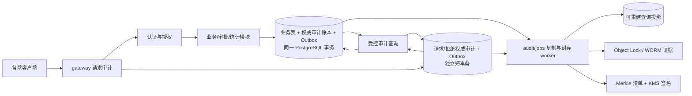

# 全链路审计追踪架构

- 状态：已采用
- 日期：2026-09-15
- 当前实现说明：登录已改为仅账号密码，MFA/step-up 已移除；本文涉及 MFA/step-up 的内容为长期设计，不代表当前行为，见 [ADR-0005](decisions/0005-password-only-login-and-incremental-persistence.md)。
- 目标：所有受保护操作可归因、可关联、可验证完整性、不可静默篡改

## 1. 审计保证边界

“任何操作可审计”在本系统中定义为：

- 所有登录、登出、刷新、MFA、会话撤销和身份工作区切换。
- 所有授权允许与拒绝，特别是账户、角色、capability 和 scope 变更。
- 所有受保护 API，包括单条读取、列表、搜索、统计和缓存命中。
- 所有创建、修改、删除、恢复和批量处理。
- 所有导出申请、生成、批准、下载、过期和撤销。
- 所有审批提交、通过、驳回、退回、撤回、转办、委托和自动流转。
- 所有组织主数据、字典和字段配置变更。
- 所有后台任务、人工重试、死信重放和数据修复。
- 所有审计查询、详情查看、敏感字段解密、导出、完整性检查和保留策略变更。

服务端是权威审计来源。客户端可以上报模块进入、页面曝光和按钮点击，但这些是产品遥测，可能离线、丢失或被篡改，不能替代审计证据。

对于数据读取，审计只能证明“服务端向某会话释放或尝试释放数据”，不能声称用户已经阅读。网络中断时使用 `DELIVERY_UNKNOWN` 等准确结果。

## 2. 与普通日志和埋点分离

| 数据 | 目的 | 权威性 | 内容 |
| --- | --- | --- | --- |
| 审计账本 | 合规、追责、授权解释 | 服务端权威 | 结构化、受控、不可变 |
| 运维日志/Trace | 排障和性能 | 技术证据 | 错误 ID、指标、调用链 |
| 产品遥测 | 体验和使用分析 | 客户端不可信 | 页面、点击、性能体验 |

三者使用不同 Schema、访问权限、存储和保留策略。禁止把完整 request/response 或普通文本日志当作审计账本。

## 3. 审计链路



`services/audit` 拥有事件 Schema、类型化记录接口、脱敏器、查询用例和审计表。业务模块只能调用类型化 `AuditRecorder`，不得自由拼接任意 JSON。

权威事件在请求事务或独立审计短事务内直接写入分区账本，绝不由 worker 首次创建。`services/jobs` 只消费已经提交的 outbox，负责查询投影、WORM 复制、完整性清单、签名验证、保留期和 legal hold 作业。

### 3.1 旁路与控制面审计

应用账本之外还必须接入：

- PostgreSQL 托管审计或 pgaudit：DDL、特权 DML、数据库角色、配置和 break-glass。
- 云 IAM、KMS、对象存储/CDN、备份恢复和容器/主机控制面日志。
- CI/CD 发布、数据库迁移、人工数据修复和应急凭据使用记录。

常规人员禁止直连生产写库；break-glass 凭据使用 JIT、限时和双人审批。基础设施日志进入独立安全域，与业务账本通过部署 ID、操作者 ID、request/trace ID 关联，但不把原始 SQL 参数复制进业务审计。

## 4. 事件 Envelope

每个事件至少包含：

### 4.1 标识与时间

- `event_id`：UUIDv7；同一事务先写非分区 `event_identity` 注册表，以数据库唯一约束保证跨分区全局幂等。
- `schema_version`、`event_type`、`category`。
- `ingest_sequence`：数据库分配的排序提示；允许因回滚、缓存和并发提交出现缺口或乱序，不能作为完整性证据。
- `occurred_at`：服务端认定的发生时间。
- `recorded_at`：写入时间。
- `client_reported_at`：可选且明确标记为不可信。

### 4.2 操作者

- `audit_event_actor` 是操作者归因的权威子表；`principal_kind` 为 `ACCOUNT`、`SERVICE`、`JOB`、`ANONYMOUS` 或 `EXTERNAL`，账号的具体角色与工作区另存发生时快照，不能把 `USER` 工作区误作操作者类型。
- 关系 `REQUEST_ACTOR`、`EFFECTIVE_ACTOR`、`DELEGATOR` 和 `IMPERSONATED_SUBJECT` 分别表达请求者、实际执行者、委托者和显式模拟对象；它们不再以 `actor_account_id/effective_actor_id/delegated_by` 等单列塞入主事件。
- `workspace`、管理员类型、角色快照，以及非秘密的 `session_id`、MFA/step-up 等级随 actor 关系保存；请求/有效操作者和委托方不自动写入 subject，只有确实是业务目标或受益人时才建立独立 subject 关联。

### 4.3 授权解释

- capability 与 `ALLOW`/`DENY` 结论。
- `policy_revision`、`organization_revision`、`authz_version`。
- 当前上下文角色集合快照。
- 每个目标对应的 evaluated/matched `role_assignment_id`、`authorization_grant_id`、scope dimension、scope 根节点、字段 clearance 和组织图版本；`target_kind` 可以是事件、主体、资源或 manifest。
- grant 创建时固化的来源能力包代码/版本；能力包只解释授权来源，不代替运行时 grant 求值。
- 拒绝原因码和附加业务规则，例如禁止自审。

事件级动作必须至少有一条 `target_kind=EVENT` 的授权 evidence；主体/资源动作按对应 ordinal 记录。列表、搜索、统计和导出等批量请求使用 `audit_authorization_evidence` 或不可变 manifest 按目标/同质目标组保存证据，不能在主事件中只保留一个 grant。若不同目标由不同 grant 放行，必须按决定性 assignment/grant/scope dimension/scope/clearance 分组建立 `AUTHORIZATION_TARGET_SET` manifest，并另建 `RESULT_SET` manifest 表达完整结果，禁止用多条 evidence 模糊地共同指向一个未分组的大集合。每个返回对象仍必须由其中一条完整 grant 独立满足 capability、dimension、scope 和 clearance，不能跨 grant 拼接。

### 4.4 来源与关联

- 渠道：Android、iOS、Web 用户端、Web 管理端、小程序、任务或服务。
- 应用版本、非秘密设备伪名、受控 IP、User-Agent 摘要。
- `request_id`、`trace_id`、`correlation_id`、`causation_id`。
- `idempotency_key` 使用带字段域分离和密钥版本的 HMAC，不保存原值或普通 hash。
- API route、应用 use case、模块代码。

### 4.5 操作与结果

- resource 类型、ID、版本和关联关系。
- 流程定义/版本、实例、任务和迁移动作。
- job、run、batch 和导出 ID。
- `outcome`：`SUCCESS`、`DENIED`、`FAILED`、`PARTIAL`、`RELEASED`、`DELIVERY_UNKNOWN`。
- 业务错误码、HTTP 状态、记录数和耗时区间。
- 不可变 `retention_class`、`canonicalization_version` 和最终权威 envelope 的 `payload_hash`。
- legal hold、控制面 record hash、签名密钥和签名属于后续追加的 hold/integrity/control-record seal，不原地写回事件。

审计只保存稳定错误码，异常堆栈通过 error ID 与运维日志关联。

## 5. 涉及用户、资源与字段变化

### 5.1 用户/主体关联

小集合在权威事务内建立 `audit_event_subject` 关联：

```text
event_id
subject_type     ACCOUNT / PERSON / STUDENT / OTHER
subject_id       永不复用的内部 UUID
relation         TARGET / RELEASED / CHANGED / APPROVER / BENEFICIARY
recorded_date
```

主体可以尚未开户或账号已匿名化，因此不能只使用 account ID。关联表不复制姓名、学号、手机号等可变标识。请求操作者、有效操作者和委托方只进入独立 actor 关联，不因“执行了操作”而同时进入 subject；同一人确实也是目标或受益人时才分别建立两类显式关联。

返回列表、统计、批量修改、审批和导出时，所有涉及用户都必须可关联。直接主体行属于 canonical envelope 并参与事件 hash。

每个适用的 actor、subject 和 resource 还要保存事件发生时的组织安全路径快照。路径包含当时与授权判断相关的学院、年级、班级等不可复用内部 ID、节点类型和组织 revision；多重归属保存多条有序路径。历史审计的 `ORG_SUBTREE` 判断匹配这些冻结路径，不使用当前 membership 或当前组织闭包。没有组织路径的服务、匿名主体或其他目标不能命中组织范围。

大集合在同一 PostgreSQL 事务内写入不可变、加密的 `subject_manifest`，并由 `audit_event_manifest` 引用 manifest ID、数量和 root hash；每个 item 同时携带与直接 scope snapshot 相同规范的 `target_kind`、target ordinal、path ordinal、path depth、组织节点和 organization revision。路径按叶到根稳定排序并校验连续，不允许用会变化的查询条件替代冻结路径。对象版本、密钥 ID 与密文 hash 保存在被引用 manifest/chunk 中。原事件 hash 包含 manifest 引用和 root hash；worker 异步展开到独立的 `audit_subject_index` 和组织路径索引，它们只是可重建查询投影，不参与原事件 hash，并必须与 manifest 对账。展开完成前不得把导出标记为 ready。

约 1000 人的批次仍应最终为每个主体建立查询索引行，但不能只记录会随时间变化的查询条件。

### 5.2 资源关联

`audit_event_resource` 保存资源类型、ID、关系、变更前版本和变更后版本；其适用的冻结组织路径进入同一事件的 scope snapshot。小集合在权威事务中逐一关联；大集合使用与主体相同、包含路径快照的不可变 manifest 模式。

### 5.3 字段变化

`audit_event_change` 保存：

- 稳定字段代码和数据分级。
- `CREATE`、`UPDATE`、`CLEAR`、`DELETE` 等变化类型。
- 允许记录时的脱敏前值/后值。
- 不允许保留值时的 HMAC 或“字段已变化”标志。

字段策略注册表按 `field_code` 固定 `CLEAR/MASK/HMAC/ENCRYPT/CHANGE_ONLY/FORBIDDEN`，并生成类型化记录代码。HMAC 包含字段域和密钥版本；低熵秘密不得以 HMAC 形式保留。

角色、capability、学院、年级、班级 scope、有效期和授权来源应记录完整安全值。密码或认证因子只能使用 `CHANGE_ONLY`，绝不记录值、哈希或可验证派生物。

## 6. 必备事件目录

- `AUTH.*`：登录尝试/成功/失败、MFA、刷新、撤销、退出、找回、锁定和设备信任。
- `SESSION.*`：工作区切换、step-up、过期、强制退出和代理开始/结束。
- `AUTHZ.*`：拒绝、纯授权探测、角色赋予、授权、scope、策略和授权版本变化；普通业务 ALLOW 作为该用例终态事件的 evidence，不为每次内部策略检查重复创建事件。
- `ACCESS.*`：单条读取、列表、搜索和统计的授权释放、响应完成或传输未知阶段；记录受控筛选字段、分页、结果数及主体清单。
- `EXPORT.*`：申请、批准、生成、ready、下载票据签发、对象传输开始/完成、失败、过期和撤销。
- `MUTATION.*`：创建、修改、删除、恢复、批量处理和字段差异。
- `ACCOUNT.*`：账号全生命周期、认证方式、状态和会话管理。
- `ORGANIZATION.*`：组织节点、成员关系、字典和字段配置。
- `WORKFLOW.*`：提交、撤回、通过、驳回、退回、转办、委托、超时和自动流转。
- `REPORT.*`：统计口径、查询、生成、导出和下载。
- `NOTIFICATION.*`：通知偏好、站内消息、推送投递、重试、失败和回执。
- `JOB.*`：调度、开始、结果、重试、死信、重放和人工触发。
- `AUDIT.*`：搜索、详情、解密、导出、下载、批注、legal hold、保留策略和完整性验证。

审计系统访问写入同一账本，但插入审计记录本身不再次递归触发无限事件。

## 7. 可靠写入

### 7.1 业务写操作

业务变更、`event_identity`、审计事件、权威主体/资源/字段关联或 manifest，以及 outbox 在同一 PostgreSQL 本地事务提交。任一写入失败则业务回滚，禁止同步双写远程审计服务或 RabbitMQ。

非分区 `event_identity(event_id PK, recorded_date, idempotency_hash)` 保证跨日期全局幂等。该 hash 覆盖调用方提交的规范化不可变内容，不包含数据库生成时间和 sequence；事件表另存最终 envelope 的 `payload_hash`。重复 event ID 且 idempotency hash 相同视为重放；hash 不同属于完整性事件并立即告警。消费者按至少一次投递设计，系统不得宣称 exactly-once。

### 7.2 失败和拒绝

校验失败、业务回滚和鉴权拒绝没有成功业务事务，由统一异常处理器使用独立短事务写入 `FAILED` 或 `DENIED`。gateway 的请求 envelope 提供请求到达证据，并与业务事件通过 request/trace ID 关联。

业务回滚不得留下 `SUCCESS` 事件；失败审计本身写入失败必须触发告警和对应失败策略。

### 7.3 读取、查询与导出

受保护数据在响应释放前收集将要返回的主体和资源，持久化 `ACCESS.RELEASE_AUTHORIZED`/`RESPONSE_READY` 后才开始返回；缓存命中同样执行。只读副本或投影产生的结果在主库复核前必须留在服务端，不能签发下载票据、写入客户端缓存或开始响应；复核失败时丢弃结果 manifest、临时文件和解密缓冲，导出 worker 也必须遵守同一边界。

发送结束后只能追加 `RESPONSE_COMPLETED` 或 `DELIVERY_UNKNOWN` 阶段事件，不能修改发送前事件。即使网络栈报告完成，也只证明服务端/传输层释放了数据，永不记录 `VIEWED`。

流式响应和导出先封存 manifest。下载拆分为 `DOWNLOAD_TICKET_ISSUED` 与 `OBJECT_GET_STARTED/COMPLETED`：严格追踪时走受控下载 gateway；使用对象存储/CDN 时必须一票一链接，并把 data-plane access log、object version 与 ticket/request ID 接入审计。上传完成、覆盖和删除同样接入对象存储事件。

### 7.4 失败策略

以下操作无法持久化审计时必须 fail closed：

- 账号、认证、角色、capability、scope 和组织配置。
- 管理员和系统管理员的全部读写。
- 审批、批量处理、统计导出和审计访问。
- 涉及个人信息的业务写操作。

首期所有受保护读取在权威审计 sink 不可用时同样 fail closed。API 副本保持无状态，不使用容器临时盘或内存队列充当审计 spool。未来只有正式设计具备持久卷、fsync、加密、配额、恢复、缩容阻断和幂等 replay 的高可用 journal 后，才可重新评估。

公开静态内容不属于受保护审计范围。

WORM 复制暂时失败时允许有界积压并告警；超过容量或 RPO 阈值暂停高风险管理操作。

## 8. 防篡改

- 业务数据库账号对审计表只有 INSERT 权限，无 UPDATE/DELETE。
- 审计查询账号只读；归档和过期清理由独立受控数据库角色执行。
- 数据库 trigger 拒绝更新和删除，但明确 PostgreSQL 超级用户仍可绕过。
- 已提交事件以明确的封存 RPO 持续复制到不同安全域账号下启用 Object Lock/WORM、版本控制和 compliance retention 的对象存储；首期目标从 1-5 分钟压测确定。
- KMS 密钥与数据库分离，并保留签名密钥轮换记录。

不能为每条事件维护单一全局 hash 链，这会形成写入热点。正确方式是：

1. 按版本化 canonicalization 规则对完整权威 envelope 计算 SHA-256；小集合包含排序后的 actor/subject/resource、冻结组织路径、变化、授权和查询来源等直接关联，大集合包含不可变 manifest 引用与 hash。
2. 按 retention class、1-5 分钟时间窗和分片，以明确的 event leaf 清单与 count 建立同质批次 Merkle tree。
3. 使用 KMS 非对称密钥签名批次 root，并将 manifest 与事件映射写入 WORM；签名信息只属于 integrity manifest。
4. 每日清单汇总当日批次 root 并链接上一日清单 hash。
5. 定时全量和随机抽样验证；删除、修改、重排、leaf/count 不一致触发告警。普通 sequence 缺口或乱序不单独视为篡改。

事务内的 `audit_event_subject` / `audit_event_resource` / `audit_event_scope_snapshot` / `audit_event_control_record` 直接关联是权威 envelope 的一部分；从 manifest 异步展开到 `audit_subject_index` / `audit_resource_index` / scope index 的关系行是可重建查询索引，不进入原 hash，完整性检查通过 manifest 对账检测缺失或篡改。

完整性批次、验证结果、归档目录/状态迁移和 legal hold case/transition 不能只靠创建事件的三元组证明未被替换。每条长期控制记录都要计算独立 canonical record hash，并由 KMS 签名、WORM 对象版本和 `audit_event_control_record` 记录锚定事件；`integrity_batch.batch_hash` 作为批次 record hash，其余控制表保存独立 `record_hash`。record hash 覆盖全部不可变业务字段、引用 ID、manifest/root/hash 和事件逻辑引用，但排除自身 hash、签名/WORM 元数据以及回指事件的 `payload_hash`，避免循环。验证时必须同时重算 record hash、验证 KMS/WORM seal，并核对锚定事件中的 hash；任一失败都告警并 fail closed。锚点作为直属事件子表随事件归档，长期 seal 使用逻辑事件引用，以免阻塞热分区 detach。

修正错误审计只能追加 `CORRECTION` 或 `SUPERSEDES` 事件，永不原地修改。

## 9. 绝不能记录的内容

以下信息不得进入审计、应用日志或 Trace：

- 明文密码、旧密码、密码哈希。
- access/refresh token、Cookie、Authorization header。
- OAuth/微信临时 code、API key/secret。
- MFA seed、OTP、恢复码、私钥和数据库连接串。
- 原始生物特征、支付敏感认证数据。
- 文件二进制、文件正文、完整 request/response body。
- 整段 SQL 参数和未脱敏异常堆栈。

身份证、手机号、邮箱、精确地址、搜索词、IP 和设备标识按目的使用掩码、字段域分离且带密钥版本的 HMAC，或字段级加密。HMAC 密钥与业务密钥分离轮换，禁止对密码、验证码等低熵秘密做可离线验证的摘要。

自由文本审批理由限制长度并执行 DLP/脱敏。理由正文应留在有权限控制的业务记录中，审计默认只保存 reason record ID、内容摘要和分类；只有明确合法目的时才保存脱敏正文。

“详细”是指上下文、对象、授权依据、结果和安全差异完整，不是复制所有原始数据。审计数据本身属于高度敏感信息。

## 10. 存储、分区与归档

首期使用 PostgreSQL 独立 `audit` schema 即可，不预先引入 Kafka 或 OpenSearch：

- 分区粒度由压测事件率和关联 fan-out 决定；按当前 200 RPS/500 RPS 验证目标必须从日分区或周分区评估，不能默认先建可能达到数亿行的月分区。若不同 retention class 的热存期限不同，则在日期下按 class 子分区或把整日分区保留到其中最长期限，禁止提前删除长保留事件。
- 分区表和权威关联表的键包含 `(recorded_date, event_id)`；非分区 `event_identity` 单独保证 event ID 全局唯一。
- 时间范围使用 BRIN；actor、subject、event type、resource、request/trace ID 使用克制的 B-tree 索引。
- 不为任意 JSONB 建宽泛 GIN 索引。
- 大型审计查询可以走只读副本或独立审计投影，但返回前仍须在主库短事务中重新校验当前会话、授权与 revision，并通过类型化 `audit_event_query_source` 子记录持久化来源代码、checkpoint/LSN、`asOf`、查询摘要、来源授权/组织 revision 和实际结果 manifest。该子记录参与事件 hash；投影 checkpoint 不得落后于本次决定所需 revision。释放前还要解密并验证权威 manifest root/object version/item count，逐 item 核对主体、资源、关系和冻结路径，并用同一 grant 重新求值 capability、dimension、scope、clearance。无法满足时等待、改走权威 manifest/full scan 或 fail closed，不能释放陈旧范围中的数据；周期性对账不能替代释放前的权威复核。

容量必须按下面的真实量测估算：

```text
event_count x (event row + event indexes + WAL/replica)
+ subject_link_count x (subject link + indexes)
+ resource/change/evidence/manifest rows
+ query projection and WORM/archive replicas
```

容量模型使用各事件类型占比以及 subject fan-out 的 p50/p95/p99。若 200 RPS 全天持续就是 1728 万事件/日，远高于普通“1000 人在线”的常见行为；压测还要覆盖“多数单主体 + 少量 1000 主体批次”，不能用在线人数直接估算。

保留策略由业务、法律和安全负责人确认。工程起点可按 retention class 分开：普通访问热存约 90 天并短期归档；敏感访问热存约 180 天并归档约 3 年；账户、授权、审批、导出和审计控制事件热存约 180-365 天并 WORM 保留约 5-7 年。正式期限必须按适用法规和业务目的批准。

归档对象按 retention class + 日期分组，catalog 保存 object version、hash、加密 key、lock mode 与 `lock_until`。legal hold 通过追加 `LEGAL_HOLD.PLACED/RELEASED` 事件和独立物化状态覆盖事件、主体、资源、时间范围或归档对象，不修改原事件；hold coverage 的 manifest kind、item count、root hash 和每个 item 都在 transition 同一事务中校验。hold 阻止证据删除，但不必阻止已验证的热层迁移。

归档和分区生命周期必须按以下顺序执行：

1. 停止目标事件分区写入并完成封存标记。
2. 验证 WORM 对象版本/锁、Merkle leaf/count/root、KMS 签名、控制面 record hash 和活动 legal hold coverage。
3. 按 destination policy 清理已达到 `replay_until` 且完成 disposition 的 `PUBLISHED` outbox；`PENDING`、`IN_FLIGHT`、`DEAD` 和未到期 `PUBLISHED` 都阻断。
4. 重新查询并确认目标事件分区不存在任何 outbox 引用。
5. 将所有直属事件子表分区（含 actor、subject、resource、scope snapshot、change、evidence、manifest link、query source、correction、safe extension 和 control-record anchor）写入冷归档并完成恢复抽检。
6. 从热父表 `DETACH` 已验证的直属子表分区。
7. 如果冷库保留这些子表，先在已封存副本上移除其指向热事件分区的外键；否则删除冷表副本，并记录约束切换证据。
8. 将归档覆盖、约束切换、所有 outbox 引用清零和 detach 结果写入控制面审计证据。
9. 只有确认所有引用方均已脱离、删除或改为逻辑引用后，才能 `DETACH` 事件分区；不能仅 detach 子表后保留其指向热事件分区的 FK。
10. 保留全局 `event_identity`、控制面 seal 和 `(recorded_date, event_id, payload_hash)` 逻辑引用；冷事件恢复时必须先通过 archive catalog/WORM 解析并验证该三元组，再允许读取或重建索引。逻辑引用在同一快照无法验证或 archive catalog 缺失时 fail closed。

## 11. 审计查询权限

审计原子能力独立拆分：

```text
audit.search
audit.detail.read
audit.sensitive.read
audit.export
audit.legal-hold.manage
audit.retention.manage
audit.integrity.verify
```

其中 `audit.search/detail/sensitive/export` 使用 `AUDIT_QUERY` 授权 profile；legal hold、保留策略和完整性操作使用普通 `GENERAL` 系统资源授权，不因此获得审计事件业务正文。

原子能力按最小权限组装为能力包；能力包是普通 IAM grant 的模板，不是第四级身份，也不允许绕开 capability、scope dimension、scope 与字段 clearance 的联合求值：

| 能力包 | 默认能力 | 适用边界 |
| --- | --- | --- |
| `AUDIT_SELF_REVIEW` | `audit.search`、`audit.detail.read` | 仅 `ACTOR=SELF`，用于管理员查看自己的操作，字段默认脱敏 |
| `AUDIT_SCOPED_INVESTIGATION` | `audit.search`、`audit.detail.read` | 必须显式绑定 scope 维度与组织根节点，不包含敏感解密和导出 |
| `AUDIT_SENSITIVE_REVIEW` | `audit.sensitive.read` | 创建限时 grant 并重复绑定获批调查范围与敏感字段分类，要求 step-up、JIT 和用途/工单 |
| `AUDIT_EXPORT_REVIEW` | `audit.export` | 创建限时 grant 并重复绑定获批查询范围，只能导出其自身 grant 可查看的数据，默认要求双人批准 |
| `AUDIT_EVIDENCE_CUSTODIAN` | `audit.legal-hold.manage`、`audit.retention.manage` | 管理证据生命周期，不因此获得业务正文读取权 |
| `AUDIT_INTEGRITY_OPERATOR` | `audit.integrity.verify` | 查看 hash、manifest 和验证结果，不因此获得事件敏感正文读取权 |

每条审计查询 grant 必须绑定 capability、字段 clearance、组织范围和以下恰好一种 `audit_scope_dimension`，禁止从不同 grant 分别拼接后产生串权：

- `ACTOR`：按事件的请求操作者、有效操作者或明确记录的委托方筛选，不包含被模拟身份。`SELF` 只适用于此维度。
- `SUBJECT`：按事件关联的目标、被读取者、被修改者、审批相关人等主体筛选。
- `RESOURCE`：按事件关联资源及其操作时冻结的组织归属或 scope 快照筛选，不能用当前组织关系改写历史事实。

一次调查可以持有多个不同 dimension 的完整 grant，并对各 grant 独立求值后合并候选集；每个返回对象仍必须由其中一条 grant 独立满足 capability、dimension、scope 和 clearance，并记录决定性 evidence。

维度只决定候选事件，不能自动放开事件中的全部内容。`ORG_SUBTREE` 必须匹配对应 actor/subject/resource 的事件时冻结组织路径；一个事件同时涉及范围内外主体或资源时，响应仍按同一 grant 的字段 clearance 和每个关联对象的范围逐项脱敏。只有显式全局审计授权才能查看范围外关联。审计查询事件必须记录命中 grant 的来源能力包、grant、scope 维度、组织根节点、字段分类集合和脱敏策略版本。

系统管理员可因职责被显式授予某个审计能力包，但系统管理员角色本身不天然拥有敏感解密、导出、保留策略或全局业务审计能力，更不能删除自己或他人的审计记录。普通管理员默认只有 `AUDIT_SELF_REVIEW`；调查管辖用户或资源必须另行授予 `AUDIT_SCOPED_INVESTIGATION`。

敏感解密和导出要求 step-up、用途/工单、限时授权；必要时双人批准。break-glass 访问必须限时、说明原因、即时通知并事后复核。

审计导出文件加密、水印、短期一次性下载链接、下载次数限制和自动过期。搜索、详情、解密、导出与每次下载都记录 `AUDIT.*` 事件。

## 12. 监控与 SLO

至少监控：

- 权威审计插入 p50/p95/p99、失败率，以及由审计不可用触发的 fail-closed 数量。
- `event_identity` 同 hash 重放数量、跨日期重放数量，以及同 event ID 不同 hash 的冲突告警；普通 sequence 缺口不监控为完整性故障。
- outbox age、积压数量、重复投递、`DEAD` disposition、`replay_until` 违规和未清零的分区引用。
- 请求/响应、导出和对象传输阶段事件的未闭合数量与超时；未闭合表示待调查，不得自动补写虚假的成功事件。
- subject/resource fan-out、manifest 生成与展开延迟、派生索引和权威 manifest 的对账差异。
- Merkle 批次声明的 leaf/count 与实际事件映射差异、root/签名验证失败和未封存时间窗。
- 分区预创建、单分区行数/字节数、索引增长、归档覆盖率和 legal hold 阻塞情况。
- WORM 复制延迟、对象版本或 hash 不匹配、KMS 故障，以及旁路/控制面审计源的摄取延迟。
- 控制面 record hash、KMS seal、WORM 版本和 `audit_event_control_record` 锚点不一致。
- 审计查询越权拒绝、敏感解密、导出、break-glass 和一次性下载票据的异常使用。
- NTP 时钟偏移和 occurred/recorded 时间差。

已提交的业务变更允许丢失的权威审计事件数为 0，受保护数据在缺少前置阶段事件时允许释放的次数为 0，同 event ID 不同 hash 被系统接受的次数为 0。审计 microbatch 封存、WORM 复制、查询投影和归档的 RPO/RTO 在部署前分别量化。

## 13. 测试门槛

- CI 检查每个受保护 OpenAPI 端点和后台 job 都声明事件类型、capability、主体提取器、字段分级和保留类别。
- 单元/属性/模糊测试覆盖 Schema、脱敏、HMAC、规范化 JSON、Merkle 和秘密泄漏。
- 业务事务与权威审计必须保持原子性；业务提交必有事件，业务回滚不得留下 `SUCCESS`，重复投递与乱序不得破坏账本完整性。
- `event_identity` 测试覆盖同 event ID/同 hash 幂等重放、跨 UTC 日期重放、同 event ID/不同 hash 拒绝并告警；sequence 的正常缺口和乱序不得产生完整性误报。
- manifest/Merkle 测试覆盖 leaf 缺失、增加、重复、重排、内容改变、声明 count 不符、object version/hash 不符和签名密钥轮换；任一不匹配都必须阻止封存或触发完整性告警。
- 控制面完整性测试覆盖 batch/verification/archive/legal-hold 记录替换、record hash、KMS/WORM seal 和事件锚点不一致；任一不匹配都必须告警并 fail closed。
- 派生索引测试从权威 subject/resource manifest 全量重建身份及冻结组织路径索引，并检测遗漏、路径篡改、越界关联和错误 expansion 状态；删除派生索引不得破坏权威证据。
- 阶段事件测试覆盖响应开始前崩溃、传输中断、对象存储回调延迟和重复、票据重放；系统只能追加准确的终态或保持未闭合，不得修改前置事件或伪造 `RESPONSE_COMPLETED`。
- 权限测试覆盖能力包展开来源、`ACTOR/SUBJECT/RESOURCE` 三种维度、事件时组织路径、同事件范围内外主体脱敏、不同 grant 禁止拼接、刚撤权、身份切换、调查本人、break-glass 和导出。
- 只读副本/投影测试覆盖 checkpoint 前进、撤权竞态、组织 revision 滞后、query source 缺失或篡改，以及主库复核失败时不释放结果。
- outbox 生命周期测试覆盖最短 replay 窗口、`DEAD` 重放、双人 disposition、删除前审计和分区 detach 阻断。
- legal hold 测试覆盖 target kind 类型互斥、事件/manifest/batch/archive hash、空 RELEASE manifest、generation 外键、coverage 与最新 transition 对账，以及任一逻辑引用无法解析时 fail closed。
- 故障注入覆盖数据库、磁盘、outbox relay、可选 RabbitMQ、WORM、KMS、对象存储审计源、时钟漂移和提交前后进程崩溃；所有受保护操作验证 fail closed。
- 防篡改测试主动修改、删除或增加权威事件、直接关联、manifest、批次映射和归档对象，验证 microbatch Merkle、KMS 签名与 WORM 对账均能发现异常。
- 恢复演练覆盖归档还原、派生索引重建、密钥轮换、legal hold 放置/解除、coverage 与最新 transition/manifest 对账、按 retention class 过期清理、全部 outbox 引用清零和 archive coverage 校验。
- k6 在完整审计开启时执行持续与突发压力测试，并单测 1000 主体批量操作和导出。

概念表结构见 [权限与审计数据模型](../database/access-control-and-audit-model.md)，决策记录见 [ADR-0003](decisions/0003-authoritative-audit-ledger.md)。
