# 权限与审计实现级数据模型

- 状态：架构基线
- 日期：2026-09-15
- 当前实现说明：登录已改为仅账号密码，MFA/step-up 已移除；本文涉及 MFA/step-up 的内容为长期设计，不代表当前行为，见 [ADR-0005](../architecture/decisions/0005-password-only-login-and-incremental-persistence.md)。
- 数据库：同一 PostgreSQL 集群，按模块 Schema 分区所有权

## 1. 数据库原则

用户端、管理员端和系统管理员端共用同一套账号与业务数据库。客户端不直接连接数据库，所有访问经服务端认证、授权和审计。

首期建议 Schema：

```text
iam          账号、角色、capability、grant、会话
org          学院/年级/班级、成员关系、字典
catalog      工作区与模块目录
business     核心业务数据；后续可按业务域拆 Schema
workflow     流程定义、实例、任务和迁移
reporting    统计投影和导出任务
notification 站内消息、推送、投递尝试和通知偏好
audit        只追加审计账本
```

模块只能通过拥有者提供的应用接口访问数据。授权所需的跨 Schema 过滤通过拥有者提供的受控只读视图/投影完成；使用同一数据库不等于允许跨模块任意 JOIN 或修改他人表。

## 2. 核心关系

```mermaid
erDiagram
    ACCOUNT ||--o{ ROLE_ASSIGNMENT : has
    ROLE ||--o{ ROLE_ASSIGNMENT : assigned_as
    ROLE ||--o{ ROLE_CAPABILITY : limits
    CAPABILITY ||--o{ ROLE_CAPABILITY : allowed_by
    ROLE ||--o{ ROLE_SCOPE_POLICY : constrains
    CAPABILITY ||--o{ ROLE_SCOPE_POLICY : scoped_by
    ROLE_ASSIGNMENT ||--o{ ASSIGNMENT_SCOPE_CEILING : bounds
    ORG_UNIT o|--o{ ASSIGNMENT_SCOPE_CEILING : roots_at
    ROLE_ASSIGNMENT ||--o{ AUTHORIZATION_GRANT : owns
    AUTHORIZATION_BUNDLE ||--o{ AUTHORIZATION_GRANT : sourced_from
    AUTHORIZATION_GRANT ||--o{ GRANT_CAPABILITY : binds
    CAPABILITY ||--o{ GRANT_CAPABILITY : included
    AUTHORIZATION_GRANT ||--o{ GRANT_SCOPE : binds
    AUTHORIZATION_GRANT ||--o{ GRANT_FIELD_CLEARANCE : limits_fields
    ORG_UNIT o|--o{ GRANT_SCOPE : optionally_roots_at
    ORG_UNIT ||--o{ ORG_UNIT : parent_of
    ORG_UNIT ||--o{ ACCOUNT_MEMBERSHIP : contains
    ACCOUNT ||--o{ ACCOUNT_MEMBERSHIP : belongs_to
    ACCOUNT ||--o{ SESSION : opens
    EVENT_IDENTITY ||--|| AUDIT_EVENT : registers
    AUDIT_EVENT ||--o{ AUDIT_EVENT_SUBJECT : involves
    AUDIT_EVENT ||--o{ AUDIT_EVENT_RESOURCE : touches
    AUDIT_EVENT ||--o{ AUDIT_EVENT_CHANGE : changes
    AUDIT_EVENT ||--|{ AUDIT_EVENT_ACTOR : attributed_to
    AUDIT_EVENT ||--o{ AUDIT_EVENT_SCOPE_SNAPSHOT : freezes_scope
    AUDIT_EVENT ||--o{ AUDIT_AUTHORIZATION_EVIDENCE : justified_by
    AUDIT_EVENT ||--o{ AUDIT_EVENT_MANIFEST : describes_sets_with
    AUDIT_EVENT ||--o{ AUDIT_EVENT_QUERY_SOURCE : queried_from
    AUDIT_EVENT ||--o{ AUDIT_EVENT_CONTROL_RECORD : anchors
    MANIFEST ||--o{ AUDIT_EVENT_MANIFEST : linked_from
    AUDIT_EVENT_CONTROL_RECORD ||--|| CONTROL_RECORD_SEAL : sealed_by
    AUDIT_EVENT ||--o{ OUTBOX : publishes
    INTEGRITY_BATCH ||--|{ INTEGRITY_BATCH_EVENT : seals
    AUDIT_EVENT ||--o| INTEGRITY_BATCH_EVENT : included_in
```



## 3. IAM 表

### `iam.account`

```text
id UUIDv7 PK
lifecycle_status ACTIVE / GRADUATED / DELETED
security_status NORMAL / TEMPORARILY_LOCKED / MANUALLY_LOCKED
display_name
person_no
authz_version BIGINT
credential_version BIGINT
created_at, updated_at
graduated_at, graduated_by, graduated_reason
deleted_at, deleted_by, deleted_reason
anonymized_at
row_version
```

自然人内部 ID 永不复用。登录名、手机号、微信标识等放在单独的受保护 identity 表并设置唯一约束，不把可变登录名当外键。`GRADUATED` 与 `DELETED` 均禁止登录并撤销会话；“删除”是产品语义的逻辑删除，不删除授权历史或审计证据。后续合规注销按保留策略匿名化允许清除的身份字段。

第一阶段普通用户的身份证号、手机号、现家庭住址和户籍地址属于受限制个人信息。本人日常查询只返回脱敏投影，明文读取必须以当前密码复核并限定为单字段、单次响应；系统管理员只可在账户已由本人完成首次资料填写后进行纠错。审计 `changes` 对这些字段仅保存字段名、分类和前后是否存在，不保存明文、哈希派生值或可逆片段。

密码凭据、MFA 因子、refresh token 和详细会话表的第一阶段字段与约束见 [第一阶段账户与权限 Schema 计划](phase-1-account-access-schema.md)。

### `iam.security_revision`

```text
singleton_key
policy_revision BIGINT
organization_revision BIGINT
updated_at
```

角色模板/capability 变化递增 `policy_revision`；组织图变化递增 `organization_revision`。授权缓存键同时包含账号 `authz_version` 和这两个全局 revision。实现可在证据充分时细化为分组织 revision，但不得遗漏受影响主体。

### `iam.role`

```text
id
code USER / TEACHER_ADMIN / STUDENT_ADMIN / SYSTEM_ADMIN
identity_kind USER / ADMIN / SYSTEM_ADMIN
admin_kind nullable
built_in
status
version
```

内置角色不可物理删除。新增业务角色仍必须归属身份空间，并通过策略定义允许的 capability 与 scope 类型。

### `iam.capability`

```text
id
code unique
resource_type
action
risk_level
scope_resolver
authorization_profile GENERAL / AUDIT_QUERY
step_up_required
status
```

### `iam.role_capability` 与 `iam.role_scope_policy`

这两张表定义角色模板的授权上限，而不是账号当前授权：

```text
role_capability(role_id, capability_id)
role_scope_policy(
  id UUIDv7 PK,
  role_id, capability_id, scope_dimension, scope_type,
  allowed_org_unit_type nullable, allowed_field_classification nullable,
  UNIQUE NULLS NOT DISTINCT(
    role_id, capability_id, scope_dimension, scope_type,
    allowed_org_unit_type, allowed_field_classification
  )
)
```

`role_capability` 定义角色可授予的 capability 总集；`role_scope_policy` 再按具体 capability 约束可配的 dimension、scope、组织节点类型和单个字段分类，不能用某 capability 的高敏 clearance 放宽同角色下另一 capability。

### `iam.role_assignment`

```text
id
account_id
role_id
status ACTIVE / REVOKED / EXPIRED
valid_from, valid_to
granted_by, grant_reason
revoked_by, revoked_at, revoke_reason
created_at, version
```

角色赋予只撤销，不物理删除。系统管理员给自己授权和撤销最后一个系统管理员由服务层及数据库保护规则共同阻止。

### `iam.assignment_scope_ceiling`

管理员角色赋予的账号级管辖上限独立保存：

```text
id UUIDv7 PK
role_assignment_id
scope_type ORG_SUBTREE
org_unit_id
org_unit_type_snapshot COLLEGE / GRADE / CLASS
created_at
UNIQUE(role_assignment_id, org_unit_id)
```

`TEACHER_ADMIN` 必须至少有一个 `GRADE` ceiling；`STUDENT_ADMIN` 必须至少有一个 `COLLEGE`、`GRADE` 或 `CLASS` ceiling，允许混合多选。`USER` 使用隐含 `SELF`，`SYSTEM_ADMIN` 在系统管理资源上使用隐含 `GLOBAL`，两者不得写组织 ceiling。

ceiling 只定义该 assignment 未来可使用的最大管辖范围，不直接授予任何业务 capability。管理员 grant 的每条 `ORG_SUBTREE` scope 必须被同一 assignment 的某个 ceiling 节点覆盖；不能引用另一个 assignment 的 ceiling。ceiling 聚合不原地修改，范围变化通过撤销旧 assignment 并创建新 assignment、ceiling 和所需 grant 表达。

### `iam.authorization_grant`

```text
id
role_assignment_id
status
valid_from, valid_to
granted_by, grant_reason
source_bundle_code nullable
source_bundle_version nullable
source_bundle_expansion_digest BYTEA nullable
revoked_by, revoked_at, revoke_reason
created_at, version
CHECK((source_bundle_code IS NULL AND source_bundle_version IS NULL AND
       source_bundle_expansion_digest IS NULL) OR
      (source_bundle_code IS NOT NULL AND source_bundle_version IS NOT NULL AND
       source_bundle_expansion_digest IS NOT NULL)),
CHECK(source_bundle_expansion_digest IS NULL OR
      octet_length(source_bundle_expansion_digest) = 32),
FK(source_bundle_code, source_bundle_version)
  -> iam.authorization_bundle(code, version) ON DELETE RESTRICT
```

能力包在授权界面展开时，受控授权过程必须解析不可变的模板版本、验证展开后的 capability/scope/clearance 与模板完全一致，再把来源代码、版本和 expansion digest 固化在 grant 上；三项来源字段必须同为 NULL 或同为非 NULL，并由 `CHECK` 和复合外键/受控过程共同保证。历史模板版本必须可追溯。这些字段只用于解释授权来源，不参与运行时放行。

### `iam.authorization_bundle`

```text
code
version
canonicalization_version INTEGER
expansion_digest BYTEA NOT NULL
contract_revision TEXT NOT NULL
definition_hash BYTEA NOT NULL
kms_key_id TEXT NOT NULL
kms_signature BYTEA NOT NULL
published_at TIMESTAMPTZ NOT NULL
retired_at TIMESTAMPTZ nullable
PK(code, version)
CHECK(octet_length(expansion_digest) = 32)
CHECK(octet_length(definition_hash) = 32)
```

`authorization_bundle` 是不可变的授权模板注册表；规范化展开内容只能包含可执行的 capability、每个 capability 的 scope policy、字段 clearance，以及对已注册策略的引用。渠道、认证强度、step-up、JIT 和用途/工单等运行时要求仍由 capability/session policy 独立求值，能力包不得自由定义一套未注册的运行时约束。展开内容及其合同提交版本写入独立受保护存储，并由 `expansion_digest`、定义 hash 和 KMS 签名封存。`authorization_grant` 的三个来源字段必须全部为 NULL 或全部非 NULL（不能只要求“成对出现”），并通过复合外键/受控过程解析该表，且保存同一 expansion digest；模板后续变更只能发布新版本，不能覆盖旧版本。能力包目录文件仍由 `packages/contracts/capabilities` 维护，但运行时授权不能只信任可变工作区文件。

### `iam.grant_capability`

```text
grant_id
capability_id
PK(grant_id, capability_id)
```

### `iam.grant_scope`

```text
id
grant_id
scope_dimension GENERAL / ACTOR / SUBJECT / RESOURCE
scope_type SELF / GLOBAL / ORG_SUBTREE
org_unit_id nullable
org_unit_type_snapshot nullable
created_at
```

`GENERAL` 用于普通业务资源；`ACTOR/SUBJECT/RESOURCE` 只用于审计查询，含义与审计架构一致。授权求值必须在同一 `authorization_grant` 内同时匹配 capability、scope dimension 和 scope。数据库约束确保 `SELF/GLOBAL` 不带 org ID、`ORG_SUBTREE` 必须带有效 org ID；审计的 `SELF` 只能搭配 `ACTOR`。

审计字段可见级别使用显式集合，不依赖易误用的数值继承：

```text
iam.grant_field_clearance(
  grant_id,
  field_classification,
  PK(grant_id, field_classification)
)
```

`authorization_profile=GENERAL` 的 capability 只能进入普通业务 grant，该 grant 只能使用 `GENERAL` scope 且不得携带审计字段 clearance。`AUDIT_QUERY` capability 所在 grant 必须选择 `ACTOR/SUBJECT/RESOURCE` 中恰好一个 dimension，包含至少一条该 dimension 的 scope，并显式列出所需字段分类。一个 grant 内的 capability profile 必须同质；不同 dimension、组织范围或字段级别建立不同 grant，禁止跨 grant 拼接 capability、dimension、scope 或 clearance。

`AUDIT_SELF_REVIEW` 等能力包只是授权界面的版本化模板，由 `packages/contracts/capabilities` 定义并在授权时展开为上述 capability、scope 与 clearance 子项；来源代码和版本固化在 grant 上并进入审计 evidence，运行时不按能力包名称放行，它也不是新的身份或角色层级。

grant 是不可变聚合。capability、scope 或 clearance 变化时撤销旧 grant 并建立新 grant，禁止直接更新或删除子项；完全重复 scope 由唯一约束拒绝，父子重叠 scope 保留直接授权意图。

授权写入只能调用受控存储过程/仓储入口，并用 `DEFERRABLE CONSTRAINT TRIGGER` 在事务提交前兜底验证：

- grant 至少包含一个 capability 和一个 scope。
- 若 grant 使用能力包，`source_bundle_code`、`source_bundle_version` 和 `source_bundle_expansion_digest` 必须同时非空，并匹配不可变 `authorization_bundle` 的 expansion digest；非能力包 grant 三者均为空。
- grant 中每个 capability 都属于角色模板上限，且所有 capability 的 `authorization_profile` 相同。
- `GENERAL` grant 必须验证全部 capability x scope 组合都有字段分类为 `NULL` 的角色策略行；`AUDIT_QUERY` grant 必须验证全部 capability x scope x clearance 组合。不能只用 `EXISTS` 证明其中一个组合合法，也不能让空 clearance 产生真空放行。
- `AUDIT_QUERY` grant 的所有 scope 必须使用同一个 dimension；多个完整 grant 可以分别放行各自候选结果，但每个结果必须由其中一条 grant 独立完整匹配。
- scope 类型和实时查询得到的 `org_unit.type` 属于角色允许范围；快照字段不参与放行。
- 教师管理员只能选择年级；学生管理员只能选择学院、年级或班级。
- 管理员 grant 的每条组织 scope 必须被所属 role assignment 的至少一个 `assignment_scope_ceiling` 覆盖；父节点通过 `org_unit_closure` 覆盖后代，禁止跨 assignment 借用 ceiling。
- `GLOBAL` 只能搭配角色模板允许的系统域 capability。
- `GENERAL` capability 只能搭配 `GENERAL` scope；`AUDIT_QUERY` capability 必须搭配角色策略允许的审计 dimension 与字段 clearance，且审计 `SELF` 只能用于 `ACTOR`。
- `ALLOW` evidence 的来源 bundle code/version/digest 必须与命中 grant 完全相同；调用方不能自行声明能力包快照。
- grant 有效期不得超出 role assignment，且结束时间晚于开始时间。

运行时数据库角色没有绕过入口直接写 grant 子表的权限。

### `iam.session` 与 `iam.session_context`

```text
session:
  id, account_id, channel, device_pseudonym, assurance_level,
  created_at, expires_at, revoked_at, revoke_reason

session_context:
  id, session_id, workspace, authz_version, policy_revision,
  organization_revision, assurance_level, audience,
  restriction NORMAL / PASSWORD_CHANGE_ONLY,
  created_at, expires_at, revoked_at
```

refresh token 只保存带独立 pepper 的哈希。明文 token、Cookie、验证码和微信临时 code 不进入数据库日志或审计正文。非系统管理员首次登录或密码重置后只能建立 `PASSWORD_CHANGE_ONLY` context；该上下文仅允许改密和退出，改密成功后撤销全部旧会话并建立新上下文。

## 4. 组织与主数据表

### `org.org_unit`

```text
id
type SCHOOL / COLLEGE / GRADE / CLASS
parent_id nullable
code
name
status ACTIVE / INACTIVE
valid_from, valid_to
version
created_by, created_at, updated_by, updated_at
```

约束层级只能为学校到学院、学院到年级、年级到班级。组织节点使用逻辑删除，不删除历史引用；删除后不再参与活动授权和组织选择，并允许重新创建相同名称和组织编号。

### `org.org_unit_closure`

```text
ancestor_id
descendant_id
depth
PK(ancestor_id, descendant_id)
```

闭包表包含节点自身的 depth 0 行，用于 SQL 范围过滤。组织迁移在同一事务更新层级、闭包关系、影响清单和审计 outbox。

### `org.account_membership`

```text
id
account_id
org_unit_id
membership_type
is_primary
valid_from, valid_to
created_at, version
```

历史业务记录保存操作时的组织快照或明确 scope 节点，避免用户转班后改变历史授权含义。

### 资源安全范围

每类受保护资源必须在 capability 契约中声明唯一 `scope_resolver`：

```text
SELF_RESOURCE       -> resource.owner_account_id
CURRENT_MEMBERSHIP  -> target account 当前有效 org.account_membership
FIXED_ORG_SCOPE     -> resource.security_scope_org_unit_id
WORKFLOW_TASK       -> 业务资源固定 scope + 当前候选资格 + task version
```

历史业务表使用不可变 `security_scope_org_unit_id`，组织名称等显示信息可保存快照。禁止仅根据当前用户班级推导历史记录范围。

### 字典与可配置字段

```text
org.dictionary_type
org.dictionary_item
```

学院、年级、班级必须是强类型组织数据，不放入无约束 EAV。只有需求确认需要用户自定义字段时，才新增带数据类型、校验、可见性、敏感级别和版本的 `custom_field_definition`，不得用单一字符串表承载所有字段。

## 5. 模块目录

```text
catalog.module_definition(
  code, title_key, icon_key, status, contract_version
)

catalog.module_exposure(
  id, module_code, workspace, channel, minimum_client_version,
  display_order, feature_flag, runtime_status, catalog_version
)

catalog.module_exposure_requirement(
  exposure_id, capability_id, match_mode ANY / ALL
)
```

同一模块通过多条 exposure 出现在不同工作区或渠道，并可使用不同 capability 要求。`ANY` 表示拥有任一要求即可显示，`ALL` 表示全部满足；该判断只控制展示，绝不参与 API 放行。

`packages/contracts/modules` 是模块定义、暴露、渠道和兼容规则的版本控制唯一来源。`services/module-catalog` 加载契约形成运行时投影，只额外保存启停、灰度和目录版本。模块代码不保存可执行 URL 或客户端类名。

当前模块目录包含 `medical-insurance`。其 exposure 分别绑定 `USER`、`ADMIN`、`SYSTEM_ADMIN` 上下文与 `module.medical-insurance.access` capability，外部系统标识为 `_yb`。SSO ticket、父会话 token 和外部角色投影属于集成边界，不写入外部业务表；`_yb` 的业务数据仍由外部项目拥有者管理。

## 6. 审计账本

### 6.1 分区键、复合键与不可变规则

`audit.audit_event` 按 `recorded_date` 做 RANGE 分区，事件子表使用相同的日期边界分区。`event_id` 单独不能作为数据库内引用键；事件及其所有直接子记录统一使用以下键：

```text
事件 PK:       (recorded_date, event_id)
事件子记录 PK: (recorded_date, event_id, ordinal)
```

`ordinal` 为从 1 开始的正整数，由 `audit.append_event(...)` 按规范化输入顺序分配。它既用于复合外键，也用于稳定重建规范化 envelope；业务调用方不得自行选择或重排。

由于 `audit.audit_authorization_evidence` 会引用 `audit.audit_event_manifest`，数据库迁移必须先创建被引用表，或用 `ALTER TABLE` 在两表均存在后添加该复合外键；文档章节顺序不代表 DDL 执行顺序。

数据库追加函数在一次调用中取得同一个 `v_recorded_at := clock_timestamp()`，并计算：

```sql
v_recorded_date := (v_recorded_at AT TIME ZONE 'UTC')::date;
```

`recorded_at` 和 `recorded_date` 均由数据库写入，API、worker 和客户端不得传入。表上保留
`CHECK (recorded_date = (recorded_at AT TIME ZONE 'UTC')::date)`，避免跨午夜或时区错误把事件及子记录路由到不同分区。

事件直属表与长期控制面使用不同引用策略：

- 与事件同保留周期、同批归档的直属子表使用包含 `recorded_date` 的完整复合外键，并明确 `ON DELETE RESTRICT`，禁止 `ON DELETE CASCADE`。
- 完整性批次、验证、归档目录、legal hold 及跨分区纠错目标等必须比热事件保留更久，使用 `(recorded_date, event_id, payload_hash)` 逻辑证据引用，不建立会阻止热分区 detach/drop 的外键。三列一律 `NOT NULL`，hash 固定 32 bytes；受控追加过程必须在同一快照中校验热事件，或通过已验证归档目录解析冷事件，并把引用纳入自身签名/WORM 证据。`audit_event_control_record` 只是随事件归档的短期直属锚点，不能替代这些长期逻辑引用。
- 禁止运行时角色直接 `UPDATE` 或 `DELETE`。
- 把外部模块 ID 当作发生时的不可变标识快照；除审计 Schema 内部关系外，不向可变业务表建立会导致证据依赖其生命周期的外键。
- 权威事件直接子表（actor、subject、resource、scope snapshot、change、authorization evidence、event manifest、query source、control-record anchor、correction、safe extension）在事件 envelope 中按表代码、各自的稳定 ordinal（scope snapshot 使用 `scope_snapshot_ordinal`）和字段顺序参加规范化 hash；outbox、完整性批次、归档目录和 legal hold 等控制面表不参加原事件 hash。

事件只能通过受控的 `audit.append_event(...)` 追加。函数先验证所有子记录，再计算完整 envelope 的 `payload_hash`，最后在同一数据库事务内写入事件身份、事件、子记录和 outbox；不存在对外可见的“未封口事件”。

### 6.2 `audit.event_identity` 与 `audit.audit_event`

分区表无法仅靠包含分区键的主键保证 `event_id` 跨日期唯一，因此先写非分区注册表：

```text
audit.event_identity(
  event_id UUIDv7 PK,
  recorded_date DATE NOT NULL,
  idempotency_hash BYTEA NOT NULL,
  registered_at TIMESTAMPTZ NOT NULL,        -- 数据库生成
  UNIQUE(event_id, recorded_date),
  CHECK(octet_length(idempotency_hash) = 32),
  CHECK(recorded_date = (registered_at AT TIME ZONE 'UTC')::date)
)
```

这里的 `idempotency_hash` 是对调用方提交的规范化、不可变事件内容计算的幂等 hash，不包含数据库分配的
`recorded_at`、`recorded_date`、`ingest_sequence` 和 outbox 状态；`audit_event.payload_hash` 则覆盖最终权威 envelope。`audit.append_event(...)` 的顺序为：

1. 规范化并验证完整输入，计算 `idempotency_hash`。
2. 尝试用本次数据库 UTC 日期插入 `event_identity`。
3. 若 `event_id` 已存在且 hash 相同，使用注册表中原 `recorded_date` 返回已有事件引用，不新建事件或 outbox；因此跨 UTC 日期重放仍幂等。
4. 若同一 `event_id` 的 hash 不同，拒绝整个调用，通过独立告警通道报告完整性冲突，绝不能覆盖原注册。
5. 首次注册时计算权威 envelope hash，并在同一事务写入下列主表及全部子表；事务回滚时注册行一并回滚。

```text
recorded_date DATE NOT NULL
event_id UUIDv7 NOT NULL
ingest_sequence BIGINT NOT NULL              -- 数据库非循环 sequence
schema_version INTEGER NOT NULL
canonicalization_version INTEGER NOT NULL

event_type, category, action
outcome SUCCESS / FAILED / DENIED / PARTIAL / RELEASED /
        DELIVERY_UNKNOWN
reason_code nullable
occurred_at TIMESTAMPTZ NOT NULL
recorded_at TIMESTAMPTZ NOT NULL             -- 数据库权威时间
client_reported_at TIMESTAMPTZ nullable

workspace nullable
session_id nullable
session_context_id nullable
assurance_level nullable
requested_capability nullable
authz_decision ALLOW / DENY / NOT_APPLICABLE
account_authz_version nullable
policy_revision BIGINT NOT NULL
organization_revision BIGINT NOT NULL

channel, app_version, device_pseudonym, masked_ip
request_id, trace_id, correlation_id, causation_id
module_code, route_template, use_case
http_status, business_error_code, result_count, duration_bucket
retention_class

payload_hash BYTEA NOT NULL                   -- SHA-256，固定 32 bytes
sealed_at TIMESTAMPTZ NOT NULL

PK(recorded_date, event_id)
UNIQUE(recorded_date, ingest_sequence)
FK(event_id, recorded_date)
  -> audit.event_identity(event_id, recorded_date) ON DELETE RESTRICT
CHECK(recorded_date = (recorded_at AT TIME ZONE 'UTC')::date)
CHECK(octet_length(payload_hash) = 32)
```

主表只保存事件级授权结论，不再保存单个 `role_assignment_id`、`authorization_grant_id` 或 `scope_snapshot`。具体到每个目标的授权证据由 `audit.audit_authorization_evidence` 保存。

`route_template` 只能保存规范化路由模板，不能保存含查询参数、令牌或用户输入的原始 URL。`masked_ip` 使用统一掩码策略；需要精确 IP 的法定安全事件应单独加密并使用更高保留等级。

操作者、有效操作者、委托方和模拟主体不再塞入主事件的单列；统一写入下一节的
`audit.audit_event_actor`。主事件的 `workspace`、会话和认证强度是事件级摘要，追加函数会校验它们与 actor 子表快照一致。

### 6.3 `audit.audit_event_actor`、主体、资源和变化

#### `audit.audit_event_actor`

这是事件归因的权威子表，与全局 `event_identity` 注册表无关。一个事件至少有一个
`REQUEST_ACTOR`；代理、代办或模拟操作还必须写入对应关系。各关系的最多一行由部分唯一索引和
`audit.append_event(...)` 共同保证。

```text
audit.audit_event_actor(
  recorded_date DATE,
  event_id UUID,
  ordinal INTEGER CHECK (ordinal > 0),
  relation REQUEST_ACTOR / EFFECTIVE_ACTOR / DELEGATOR /
           IMPERSONATED_SUBJECT,
  principal_kind ACCOUNT / SERVICE / JOB / ANONYMOUS / EXTERNAL,
  account_id UUID nullable,
  service_principal_code nullable,
  external_subject_hmac BYTEA nullable,
  identity_kind_snapshot USER / ADMIN / SYSTEM_ADMIN nullable,
  admin_kind_snapshot TEACHER / STUDENT_ADMIN nullable,
  session_id UUID nullable,
  authentication_method_snapshot nullable,
  role_codes_snapshot nullable,
  PK(recorded_date, event_id, ordinal),
  FK(recorded_date, event_id)
    -> audit.audit_event(recorded_date, event_id) ON DELETE RESTRICT
)
```

`principal_kind` 的标识约束必须由数据库 `CHECK` 和追加函数共同执行：

- `ACCOUNT` 只能填写 `account_id`；`SERVICE/JOB` 只能填写
  `service_principal_code`；`ANONYMOUS` 两者都为空；`EXTERNAL` 只能填写带独立 pepper 的稳定
  `external_subject_hmac`。
- `REQUEST_ACTOR` 恰好一行；受认证账号/服务的操作还必须有 `EFFECTIVE_ACTOR`，普通操作的有效操作者与请求操作者相同。匿名失败请求只写匿名 `REQUEST_ACTOR`。
- `DELEGATOR` 只能出现在委托/代理事件，`IMPERSONATED_SUBJECT` 只能出现在显式模拟事件；不得把被操作的目标冒充为 actor。
- `account_id`、服务代码和角色快照都是发生时的证据快照，不对可变 IAM 表建立长期外键。

#### 其他直接子表

```text
audit.audit_event_subject(
  recorded_date DATE,
  event_id UUID,
  ordinal INTEGER CHECK (ordinal > 0),
  subject_type,
  subject_id UUID,
  relation TARGET / RELEASED / CHANGED / APPROVER / BENEFICIARY,
  PK(recorded_date, event_id, ordinal),
  FK(recorded_date, event_id)
    -> audit.audit_event(recorded_date, event_id) ON DELETE RESTRICT
)

audit.audit_event_resource(
  recorded_date DATE,
  event_id UUID,
  ordinal INTEGER CHECK (ordinal > 0),
  resource_type,
  resource_id,
  relation,
  before_version nullable,
  after_version nullable,
  PK(recorded_date, event_id, ordinal),
  FK(recorded_date, event_id)
    -> audit.audit_event(recorded_date, event_id) ON DELETE RESTRICT
)

audit.audit_event_change(
  recorded_date DATE,
  event_id UUID,
  ordinal INTEGER CHECK (ordinal > 0),
  resource_ordinal INTEGER nullable,
  field_code,
  classification,
  change_kind,
  old_safe_value nullable,
  new_safe_value nullable,
  old_hmac nullable,
  new_hmac nullable,
  PK(recorded_date, event_id, ordinal),
  FK(recorded_date, event_id)
    -> audit.audit_event(recorded_date, event_id) ON DELETE RESTRICT,
  FK(recorded_date, event_id, resource_ordinal)
    -> audit.audit_event_resource(recorded_date, event_id, ordinal)
       ON DELETE RESTRICT
)

audit.audit_event_scope_snapshot(
  recorded_date DATE,
  event_id UUID,
  scope_snapshot_ordinal INTEGER NOT NULL CHECK (scope_snapshot_ordinal > 0),
  target_kind ACTOR / SUBJECT / RESOURCE NOT NULL,
  actor_ordinal INTEGER nullable,
  subject_ordinal INTEGER nullable,
  resource_ordinal INTEGER nullable,
  scope_path_ordinal INTEGER NOT NULL CHECK (scope_path_ordinal > 0),
  path_depth_from_leaf INTEGER NOT NULL CHECK (path_depth_from_leaf >= 0),
  org_unit_id_snapshot UUID NOT NULL,
  org_unit_type_snapshot SCHOOL / COLLEGE / GRADE / CLASS NOT NULL,
  scope_source CURRENT_MEMBERSHIP / FIXED_RESOURCE_SCOPE /
               EXPLICIT_BUSINESS_SCOPE NOT NULL,
  organization_revision BIGINT NOT NULL,
  PK(recorded_date, event_id, scope_snapshot_ordinal),
  UNIQUE NULLS NOT DISTINCT(
    recorded_date, event_id, target_kind, actor_ordinal, subject_ordinal,
    resource_ordinal, scope_path_ordinal, path_depth_from_leaf
  ),
  FK(recorded_date, event_id)
    -> audit.audit_event(recorded_date, event_id) ON DELETE RESTRICT,
  FK(recorded_date, event_id, actor_ordinal)
    -> audit.audit_event_actor(recorded_date, event_id, ordinal)
       ON DELETE RESTRICT,
  FK(recorded_date, event_id, subject_ordinal)
    -> audit.audit_event_subject(recorded_date, event_id, ordinal)
       ON DELETE RESTRICT,
  FK(recorded_date, event_id, resource_ordinal)
    -> audit.audit_event_resource(recorded_date, event_id, ordinal)
       ON DELETE RESTRICT,
  CHECK(
    (target_kind = ACTOR AND actor_ordinal IS NOT NULL AND
     subject_ordinal IS NULL AND resource_ordinal IS NULL) OR
    (target_kind = SUBJECT AND actor_ordinal IS NULL AND
     subject_ordinal IS NOT NULL AND resource_ordinal IS NULL) OR
    (target_kind = RESOURCE AND actor_ordinal IS NULL AND
     subject_ordinal IS NULL AND resource_ordinal IS NOT NULL)
  )
)
```

变化表只保存经字段策略允许的安全表示。密码、验证码、access/refresh token、Cookie、私钥、完整请求响应和可逆的高敏认证材料既不能保存明文，也不能保存“脱敏后”副本。

actor 与 subject 是互不替代的授权维度。请求/有效操作者和委托方只写 `audit_event_actor`；不能仅因账号执行了操作就再写一条 subject 关系，否则 `SUBJECT` 审计范围会错误命中按 `ACTOR` 才应可见的事件。同一账号确实也是目标、被读取者或受益人时可以同时出现，但两条关系必须各自具有真实业务语义。

`audit_event_scope_snapshot` 为 actor、subject 或 resource 保存事件发生时与安全判断相关的完整组织祖先路径。`scope_snapshot_ordinal` 是事件内生成的行号；真正的语义唯一键还包括 target kind、对应 target ordinal、path ordinal 和 path depth，因此同一事件可以安全记录多个目标和多条归属路径。数据库约束保证 `target_kind` 只填写对应的一种 target ordinal（另外两列必须为空），追加函数按“叶节点到根节点、同层按不可复用 ID”稳定排序，校验每条路径连续，并要求行内 organization revision 与事件一致。该表不引用可变 `org` 表，全部行参与事件 envelope hash。

审计 `ORG_SUBTREE` 查询以 grant 根节点匹配同一 dimension 的冻结路径节点，不使用当前 membership 或当前组织闭包改写历史事实。`ACTOR` 候选只包含 `REQUEST_ACTOR`、`EFFECTIVE_ACTOR` 和 `DELEGATOR`，不得把 `IMPERSONATED_SUBJECT` 当作操作者；后者若也是业务目标，必须另建真实的 subject 关联及路径。`ACTOR=SELF` 直接匹配 actor 的 `account_id`；没有适用组织路径的服务、匿名主体或其他目标不能命中 `ORG_SUBTREE`，只能在明确的 `GLOBAL` 授权下进入候选集。

### 6.4 `audit.audit_authorization_evidence`

该表保存一次事件中每个目标的授权解释，替代主事件上的单 grant/scope 字段：

```text
recorded_date DATE NOT NULL
event_id UUID NOT NULL
ordinal INTEGER NOT NULL CHECK (ordinal > 0)
decision_id UUID NOT NULL

target_kind EVENT / SUBJECT / RESOURCE / MANIFEST NOT NULL
subject_ordinal INTEGER nullable
resource_ordinal INTEGER nullable
manifest_ordinal INTEGER nullable

capability_code TEXT NOT NULL
source_bundle_code_snapshot nullable
source_bundle_version_snapshot nullable
source_bundle_expansion_digest_snapshot BYTEA nullable
decision ALLOW / DENY NOT NULL
reason_code TEXT NOT NULL
scope_resolver TEXT NOT NULL
evaluated_at TIMESTAMPTZ NOT NULL

role_assignment_id UUID nullable
authorization_grant_id UUID nullable
grant_scope_id UUID nullable
scope_type_snapshot SELF / GLOBAL / ORG_SUBTREE nullable
scope_dimension_snapshot GENERAL / ACTOR / SUBJECT / RESOURCE nullable
scope_org_unit_id_snapshot UUID nullable
scope_org_unit_type_snapshot nullable
field_classifications_snapshot TEXT[] nullable  -- 规范化排序、去重
redaction_policy_version nullable

account_authz_version BIGINT NOT NULL
policy_revision BIGINT NOT NULL
organization_revision BIGINT NOT NULL
predicate_hash BYTEA nullable

PK(recorded_date, event_id, ordinal)
FK(recorded_date, event_id)
  -> audit.audit_event(recorded_date, event_id) ON DELETE RESTRICT
FK(recorded_date, event_id, subject_ordinal)
  -> audit.audit_event_subject(recorded_date, event_id, ordinal)
     ON DELETE RESTRICT
FK(recorded_date, event_id, resource_ordinal)
  -> audit.audit_event_resource(recorded_date, event_id, ordinal)
     ON DELETE RESTRICT
FK(recorded_date, event_id, manifest_ordinal)
  -> audit.audit_event_manifest(recorded_date, event_id, ordinal)
     ON DELETE RESTRICT
CHECK(
  (target_kind = EVENT AND subject_ordinal IS NULL AND
   resource_ordinal IS NULL AND manifest_ordinal IS NULL) OR
  (target_kind = SUBJECT AND subject_ordinal IS NOT NULL AND
   resource_ordinal IS NULL AND manifest_ordinal IS NULL) OR
  (target_kind = RESOURCE AND subject_ordinal IS NULL AND
   resource_ordinal IS NOT NULL AND manifest_ordinal IS NULL) OR
  (target_kind = MANIFEST AND subject_ordinal IS NULL AND
   resource_ordinal IS NULL AND manifest_ordinal IS NOT NULL)
),
CHECK(decision <> ALLOW OR
      (role_assignment_id IS NOT NULL AND
       authorization_grant_id IS NOT NULL AND
       grant_scope_id IS NOT NULL AND
       scope_type_snapshot IS NOT NULL AND
       scope_dimension_snapshot IS NOT NULL)),
CHECK(scope_dimension_snapshot <> GENERAL OR
      COALESCE(cardinality(field_classifications_snapshot), 0) = 0),
CHECK(scope_dimension_snapshot IS NOT NULL OR
      COALESCE(cardinality(field_classifications_snapshot), 0) = 0),
CHECK(decision <> ALLOW OR scope_dimension_snapshot = GENERAL OR
      COALESCE(cardinality(field_classifications_snapshot), 0) > 0),
CHECK(scope_type_snapshot <> ORG_SUBTREE OR
      scope_org_unit_id_snapshot IS NOT NULL),
CHECK(scope_type_snapshot IN (SELF, GLOBAL) OR
      scope_org_unit_id_snapshot IS NOT NULL),
CHECK(source_bundle_expansion_digest_snapshot IS NULL OR
      octet_length(source_bundle_expansion_digest_snapshot) = 32),
CHECK((source_bundle_code_snapshot IS NULL AND
       source_bundle_version_snapshot IS NULL AND
       source_bundle_expansion_digest_snapshot IS NULL) OR
      (source_bundle_code_snapshot IS NOT NULL AND
       source_bundle_version_snapshot IS NOT NULL AND
       source_bundle_expansion_digest_snapshot IS NOT NULL)),
CHECK(target_kind <> MANIFEST OR predicate_hash IS NOT NULL),
CHECK(predicate_hash IS NULL OR octet_length(predicate_hash) = 32)
```

数据库 `CHECK` 或等价的不可绕过约束函数保证 `target_kind` 与三个目标 ordinal 恰好对应：`EVENT` 全为空，`SUBJECT` 仅 `subject_ordinal` 非空，`RESOURCE` 仅 `resource_ordinal` 非空，`MANIFEST` 仅 `manifest_ordinal` 非空。每个受保护事件至少有一条 `target_kind=EVENT` evidence；主体/资源动作和批量结果再按对应 ordinal 增加 evidence。`ALLOW` 必须填写同一次求值实际命中的 assignment、grant、grant scope、dimension 和适用 clearance；`DENY` 的授权 ID 可以为空，并用稳定 `reason_code` 区分 capability 缺失、dimension/scope 不匹配、clearance 不足、渠道错误、认证强度不足或业务约束失败。

一次 `ALLOW` 的三个授权 ID 必须来自同一条 grant 链。授权服务只能在同一 `authorization_grant` 内匹配 capability、scope dimension、scope 和字段 clearance；追加函数在授权事务仍可见时复核 grant、assignment、scope、来源能力包、来源 expansion digest 及当时 revision。`field_classifications_snapshot` 是本次决定使用的规范化、有序、去重集合，普通业务决定为空；不得用单个标量冒充多值 clearance。审计表不对 IAM 表保留长期外键，避免未来 IAM 生命周期影响证据；evidence 保存来源 digest，便于在 IAM 生命周期变化后独立核验。

批量变更为每个目标写 evidence。列表、搜索、统计或大型导出使用 `MANIFEST` 目标，并保存实际授权查询谓词的 `predicate_hash`。同一 evidence 所指 manifest 必须是由同一决定性 assignment/grant/scope 覆盖的同质目标组；不同 grant 命中的结果拆成多个 `AUTHORIZATION_TARGET_SET` manifest，另用一个 `RESULT_SET` manifest 表达完整结果集合，禁止用多条 evidence 模糊地共同指向一个未分组的大集合。存在多个可行 grant 时，求值器按稳定规则为每个目标选择一个决定性命中项；需要展示多个共同条件时，可以让同一个 `decision_id` 对应多条有序 evidence。

### 6.5 Manifest 与 `audit.audit_event_manifest`

大量主体、资源、查询结果或导出内容不能塞进主事件或任意 JSON。它们使用不可变、加密、可分块的 manifest：

```text
audit.manifest(
  manifest_id UUIDv7 PK,
  manifest_kind SUBJECT_SET / RESOURCE_SET / QUERY_RESULT / EXPORT_CONTENT /
                AUTHORIZATION_TARGET_SET / LEGAL_HOLD_SCOPE NOT NULL,
  schema_version INTEGER NOT NULL,
  canonicalization_version INTEGER NOT NULL,
  item_count BIGINT NOT NULL,
  selection_definition_version nullable,
  selection_digest BYTEA nullable,
  chunk_count INTEGER NOT NULL,
  root_hash BYTEA NOT NULL,
  encryption_algorithm TEXT NOT NULL,
  kms_key_id TEXT NOT NULL,
  encrypted_data_key BYTEA NOT NULL,
  retention_class TEXT NOT NULL,
  created_at TIMESTAMPTZ NOT NULL,            -- 数据库生成
  sealed_at TIMESTAMPTZ NOT NULL,
  CHECK(item_count >= 0),
  CHECK(chunk_count > 0),
  CHECK(octet_length(root_hash) = 32),
  UNIQUE(manifest_id, manifest_kind)
)

audit.manifest_chunk(
  manifest_id UUID NOT NULL,
  ordinal INTEGER NOT NULL CHECK (ordinal > 0),
  first_item_ordinal BIGINT NOT NULL CHECK (first_item_ordinal > 0),
  item_count INTEGER NOT NULL CHECK (item_count >= 0),
  storage_kind INLINE_CIPHERTEXT / WORM_OBJECT NOT NULL,
  encrypted_payload BYTEA nullable,
  object_bucket nullable,
  object_key nullable,
  object_version nullable,
  ciphertext_hash BYTEA NOT NULL,
  PK(manifest_id, ordinal),
  FK(manifest_id) -> audit.manifest(manifest_id) ON DELETE RESTRICT,
  CHECK(
    (storage_kind = INLINE_CIPHERTEXT AND encrypted_payload IS NOT NULL AND
     object_bucket IS NULL AND object_key IS NULL AND object_version IS NULL) OR
    (storage_kind = WORM_OBJECT AND encrypted_payload IS NULL AND
     object_bucket IS NOT NULL AND object_key IS NOT NULL AND
     object_version IS NOT NULL)
  ),
  CHECK(octet_length(ciphertext_hash) = 32)
)

audit.audit_event_manifest(
  recorded_date DATE NOT NULL,
  event_id UUID NOT NULL,
  ordinal INTEGER NOT NULL CHECK (ordinal > 0),
  manifest_id UUID NOT NULL,
  relation INPUT_SET / AFFECTED_SET / RESULT_SET / EXPORT_SET /
           AUTHORIZATION_TARGET_SET NOT NULL,
  manifest_kind_snapshot SUBJECT_SET / RESOURCE_SET / QUERY_RESULT /
                         EXPORT_CONTENT / AUTHORIZATION_TARGET_SET / LEGAL_HOLD_SCOPE NOT NULL,
  item_count_snapshot BIGINT NOT NULL,
  root_hash_snapshot BYTEA NOT NULL,
  PK(recorded_date, event_id, ordinal),
  UNIQUE(recorded_date, event_id, ordinal, relation, manifest_kind_snapshot),
  FK(recorded_date, event_id)
    -> audit.audit_event(recorded_date, event_id) ON DELETE RESTRICT,
  FK(manifest_id)
    -> audit.manifest(manifest_id) ON DELETE RESTRICT,
  FK(manifest_id, manifest_kind_snapshot)
    -> audit.manifest(manifest_id, manifest_kind) ON DELETE RESTRICT,
  CHECK(item_count_snapshot >= 0),
  CHECK(octet_length(root_hash_snapshot) = 32)
)
```

`manifest_chunk` 的 `CHECK` 保证 inline 密文与对象存储三元组只能选择一种。对象字段只保存固定 bucket/key/version，不保存预签名 URL 或凭据。每个主体或资源 item 在加密前包含稳定 ordinal、类型、关系、不复用内部 ID，以及与直接关联相同语义的冻结组织路径集合；`root_hash` 按 chunk ordinal 覆盖所有密文 hash、数量和选择定义摘要。

`manifest_id` 在所有 manifest kind 中全局唯一；`manifest_kind` 及其复合外键只是对引用时类型的冻结校验，不表示同一个 ID 可以存在多个独立集合。

manifest 只能通过封口函数创建；修改集合必须创建新 manifest。`audit_event_manifest` 保存数量和 root hash 快照并参与事件 envelope hash，使外部密文对象的替换可被检测。大型读取或导出若无法在同步事务内安全封口，必须改为异步任务，不能先把数据响应给客户端再补 manifest。

worker 可把大型 manifest 解密展开到 `audit.audit_subject_index`、`audit.audit_resource_index` 和 `audit.audit_manifest_scope_index`，以支持按主体、资源和冻结组织路径查询。身份索引按 manifest item 规范化，只保存 `manifest_id + item_ordinal + subject/resource ID + relation`，并以 `(manifest_id, item_ordinal)` 唯一；scope 索引按 `manifest_id + item_ordinal + target_kind + target_ordinal + scope_path_ordinal + path_depth` 保存组织节点快照。manifest item 的 `target_kind`、target ordinal、path ordinal、path depth、叶到根排序和连续性校验必须与 `audit_event_scope_snapshot` 使用同一规范；item ordinal 只是 manifest 内行号，不能替代目标 ordinal。查询事件时再通过 `audit_event_manifest(manifest_id, recorded_date, event_id)` 连接，因此同一不可变 manifest 可以被多个事件安全复用。这些表都是可删除、可全量重建的投影，不是权威直接子记录，不参与原事件 `payload_hash`。对账必须校验 manifest object version、root hash、item count、完整组织路径，以及展开索引无遗漏、无越界、无重复。

上述三个展开索引只能作为候选集，不能作为最终授权依据。释放结果前必须解密并验证权威 manifest 的 root hash、对象版本和 item count，逐 item 校验主体/资源 ID、关系、`target_kind`、冻结组织路径和路径顺序，再使用当前同一条 grant 重新匹配 capability、dimension、scope 和 field clearance，并核对结果 manifest 与 `audit_event_query_source`。投影缺失、滞后、篡改或对账失败时只能改走权威 manifest/full scan，或者 fail closed；周期性对账完成前不能把投影索引新增的范围直接视为已授权。

#### `audit.audit_event_query_source`

只读副本或独立投影产生的结果必须保存类型化来源证据，不能只在操作日志中留下自由文本：

```text
audit.audit_event_query_source(
  recorded_date DATE NOT NULL,
  event_id UUID NOT NULL,
  ordinal INTEGER CHECK (ordinal > 0),
  source_kind READ_REPLICA / REPORTING_PROJECTION / AUDIT_PROJECTION NOT NULL,
  source_code TEXT NOT NULL,
  checkpoint_kind PG_LSN / PROJECTION_VERSION / SNAPSHOT_ID NOT NULL,
  checkpoint_value TEXT NOT NULL,
  source_as_of TIMESTAMPTZ NOT NULL,
  source_account_authz_version BIGINT NOT NULL,
  source_policy_revision BIGINT NOT NULL,
  source_organization_revision BIGINT NOT NULL,
  query_digest BYTEA NOT NULL,
  result_manifest_ordinal INTEGER NOT NULL,
  result_manifest_relation RESULT_SET NOT NULL,
  result_manifest_kind_snapshot QUERY_RESULT NOT NULL,
  PK(recorded_date, event_id, ordinal),
  FK(recorded_date, event_id)
    -> audit.audit_event(recorded_date, event_id) ON DELETE RESTRICT,
  FK(recorded_date, event_id, result_manifest_ordinal)
    -> audit.audit_event_manifest(recorded_date, event_id, ordinal)
       ON DELETE RESTRICT,
  FK(recorded_date, event_id, result_manifest_ordinal,
     result_manifest_relation, result_manifest_kind_snapshot)
    -> audit.audit_event_manifest(recorded_date, event_id, ordinal,
                                  relation, manifest_kind_snapshot)
       ON DELETE RESTRICT,
  CHECK(octet_length(query_digest) = 32)
)
```

`source_code` 来自部署时白名单，不得包含主机凭据、连接串或预签名 URL；`checkpoint_value` 使用对应 kind 的有界规范格式。`result_manifest_relation` 固定为 `RESULT_SET`，`result_manifest_kind_snapshot` 固定为 `QUERY_RESULT`；追加函数还要在同一事务中读取被引用 manifest，拒绝快照与实际 `manifest_kind` 不一致的行。`query_digest` 覆盖规范化筛选、排序、分页、统计口径和目的，不保存原始敏感搜索词。该行、所指 `RESULT_SET` manifest 和授权 evidence 一起参与事件 envelope hash；非主库读取缺少任一项时不得释放结果。

### 6.6 纠错与安全扩展

原事件永不修改。纠错是一条新的审计事件，并通过下表引用原事件：

```text
audit.audit_event_correction(
  recorded_date DATE,
  event_id UUID,
  ordinal INTEGER CHECK (ordinal > 0),
  corrected_recorded_date DATE NOT NULL,
  corrected_event_id UUID NOT NULL,
  corrected_event_payload_hash BYTEA NOT NULL,
  correction_kind ANNOTATES / SUPERSEDES / INVALIDATES_ASSERTION /
                  LEGAL_REDACTION,
  reason_code,
  replacement_manifest_id UUID nullable,
  PK(recorded_date, event_id, ordinal),
  FK(recorded_date, event_id)
    -> audit.audit_event(recorded_date, event_id) ON DELETE RESTRICT,
  FK(replacement_manifest_id)
    -> audit.manifest(manifest_id) ON DELETE RESTRICT,
  CHECK((recorded_date, event_id) <> (corrected_recorded_date, corrected_event_id)),
  CHECK(octet_length(corrected_event_payload_hash) = 32)
)
```

法律允许的删除通过密钥销毁、替换 manifest 和 `LEGAL_REDACTION` 纠错事件实现；原 hash、纠错理由、审批人和时间仍保留。纠错本身需经过普通授权、双人复核规则及完整审计。

扩展字段不直接放任意 `JSONB`，而使用版本化白名单：

```text
audit.safe_extension_schema(
  namespace,
  schema_version INTEGER,
  json_schema JSONB,
  schema_hash BYTEA,
  maximum_bytes INTEGER,
  maximum_classification,
  created_at TIMESTAMPTZ,
  retired_at TIMESTAMPTZ nullable,
  PK(namespace, schema_version)
)

audit.audit_event_safe_extension(
  recorded_date DATE,
  event_id UUID,
  ordinal INTEGER CHECK (ordinal > 0),
  namespace,
  schema_version INTEGER,
  payload JSONB,
  payload_hash BYTEA,
  PK(recorded_date, event_id, ordinal),
  FK(recorded_date, event_id)
    -> audit.audit_event(recorded_date, event_id) ON DELETE RESTRICT,
  FK(namespace, schema_version)
    -> audit.safe_extension_schema(namespace, schema_version)
       ON DELETE RESTRICT
)
```

`audit.append_event(...)` 按注册 JSON Schema、最大字节数、字段分类和禁用键列表验证扩展，再用统一 JSON canonicalization 计算 hash。包含 `password`、`secret`、`token`、`cookie`、`authorization`、原始 header/body 等含义的字段无论是否改名都不得进入扩展。

### 6.7 `audit.outbox`

outbox 是可变的投递控制面，不属于不可变事件 envelope：

```text
outbox_id UUIDv7 PK
recorded_date DATE NOT NULL
event_id UUID NOT NULL
destination_code TEXT NOT NULL
topic TEXT NOT NULL
state PENDING / IN_FLIGHT / PUBLISHED / DEAD NOT NULL
envelope_hash BYTEA NOT NULL
created_at TIMESTAMPTZ NOT NULL
available_at TIMESTAMPTZ NOT NULL
attempt_count INTEGER NOT NULL CHECK (attempt_count >= 0)
next_attempt_at TIMESTAMPTZ NOT NULL
lease_owner nullable
lease_until nullable
published_at nullable
replay_until TIMESTAMPTZ NOT NULL
last_error_code nullable
last_error_at nullable

UNIQUE(recorded_date, event_id, destination_code)
FK(recorded_date, event_id)
  -> audit.audit_event(recorded_date, event_id) ON DELETE RESTRICT
CHECK(octet_length(envelope_hash) = 32)
```

outbox 不复制完整请求、响应或审计 payload；消费者用事件复合键读取已封口 envelope，并以
`destination_code + recorded_date + event_id` 幂等消费。`envelope_hash` 必须等于同一事件的 `audit_event.payload_hash`，由 `audit.append_event(...)` 和受控约束函数交叉校验；外键和非空约束保证不存在无事件引用的行。dispatcher 使用 `FOR UPDATE SKIP LOCKED` 领取、带租约重试并仅保存稳定错误码，不保存可能含个人信息的异常堆栈。超过重试上限进入 `DEAD` 并告警，不得把事件标记为已发布。

只有 outbox dispatcher 数据库角色可以更新投递状态。`replay_until` 不得早于该 destination 的最长消费者重放窗口、WORM 复制确认窗口和运维调查窗口的最大值；`PUBLISHED` 行在该时间前不能删除。删除 outbox 不删除事件，任何关系都不使用级联删除。`DEAD` 不能永久造成生命周期死锁：只能由受控、可审计的人工重放（恢复为 `PENDING`）或经过双人批准、独立调查和 disposition 事件的放弃处理完成；disposition 必须通过仍可用的独立审计写入路径提交，不能依赖正在处置的 dead destination；在 disposition 事件提交前禁止删除或改写该行。重放、放弃及删除动作必须保存 outbox ID、事件复合键、envelope hash、原因、批准人和时间的审计证据。

由于 outbox 外键引用事件，事件分区退出热层前必须已经没有任何对应 outbox 行；`PENDING`、`IN_FLIGHT`、`DEAD` 和尚未达到 `replay_until` 的 `PUBLISHED` 行一律阻断。只有完成上述受控 disposition、且达到 `replay_until` 的行，才能由生命周期过程删除，并在删除前再次写入 disposition 结果。

### 6.8 完整性批次

完整性批次按短时间窗和分片封口，使用当批实际已提交事件的有序 leaf 清单形成 Merkle root；`ingest_sequence` 只用于排序提示和范围索引，不要求连续，也不能以缺口或乱序判断篡改：

```text
audit.integrity_batch(
  batch_id UUIDv7 PK,
  chain_code TEXT NOT NULL,
  batch_sequence BIGINT NOT NULL,
  previous_batch_id UUID nullable,
  first_ingest_sequence BIGINT nullable,
  last_ingest_sequence BIGINT nullable,
  event_count BIGINT NOT NULL CHECK (event_count > 0),
  retention_class TEXT NOT NULL,
  canonicalization_version INTEGER NOT NULL,
  hash_algorithm TEXT NOT NULL,
  merkle_root BYTEA NOT NULL,
  previous_batch_hash BYTEA nullable,
  batch_hash BYTEA NOT NULL,
  kms_key_id TEXT NOT NULL,
  kms_signature BYTEA NOT NULL,
  sealed_at TIMESTAMPTZ NOT NULL,
  UNIQUE(retention_class, chain_code, batch_sequence),
  CHECK(octet_length(merkle_root) = 32),
  CHECK(previous_batch_hash IS NULL OR octet_length(previous_batch_hash) = 32),
  CHECK(octet_length(batch_hash) = 32),
  FK(previous_batch_id)
    -> audit.integrity_batch(batch_id) ON DELETE RESTRICT
)

audit.integrity_batch_event(
  batch_id UUID NOT NULL,
  ordinal INTEGER NOT NULL CHECK (ordinal > 0),
  recorded_date DATE NOT NULL,
  event_id UUID NOT NULL,
  ingest_sequence BIGINT,
  event_payload_hash BYTEA NOT NULL,
  PK(batch_id, ordinal),
  UNIQUE(recorded_date, event_id),
  FK(batch_id)
    -> audit.integrity_batch(batch_id) ON DELETE RESTRICT,
  CHECK(octet_length(event_payload_hash) = 32)
)

audit.integrity_verification(
  batch_id UUID NOT NULL,
  ordinal BIGINT NOT NULL CHECK (ordinal > 0),
  verified_at TIMESTAMPTZ NOT NULL,
  verifier_kind SCHEDULED / RESTORE_DRILL / MANUAL NOT NULL,
  outcome VALID / INVALID / INCOMPLETE NOT NULL,
  observed_batch_hash BYTEA,
  record_hash BYTEA NOT NULL,
  reason_code nullable,
  verification_event_recorded_date DATE NOT NULL,
  verification_event_id UUID NOT NULL,
  verification_event_payload_hash BYTEA NOT NULL,
  PK(batch_id, ordinal),
  FK(batch_id)
    -> audit.integrity_batch(batch_id) ON DELETE RESTRICT,
  CHECK(octet_length(record_hash) = 32),
  CHECK(octet_length(verification_event_payload_hash) = 32)
)
```

`integrity_batch` 按 retention class、短时间窗和分片形成同质批次，只在所有实际成员、Merkle root、前序 hash 和 KMS 签名均完成后一次插入，不保存可变 `OPEN` 状态。构建中的进度属于 jobs 控制表；成员数量和 leaf ordinal 必须与 `event_count` 一致，但不要求 ingest sequence 连续。前序批次必须属于同一 retention class/chain，事件成员的 retention class 必须与批次相同。事件规范化 hash 已覆盖 actor、subject、resource、冻结 scope 路径、变化、授权 evidence、manifest 链接、query source、control-record anchor、纠错和安全扩展；outbox 投递状态不参加 hash。

### 6.9 控制面记录的独立完整性证明

完整性批次、验证结果、归档目录/状态迁移和 legal hold case/transition 都是比热事件保留更久的控制面记录，不能只保存“创建它的事件三元组”。每条记录必须有独立的 canonical record hash，并有 KMS 签名和 WORM 封存；`integrity_batch.batch_hash` 直接作为该批次的 record hash，现有 `kms_key_id`/`kms_signature` 同时作为其签名封存字段，其余长期控制表使用下列 `record_hash` 字段并登记相同的 seal。

```text
audit.audit_event_control_record(
  recorded_date DATE NOT NULL,
  event_id UUID NOT NULL,
  ordinal INTEGER NOT NULL CHECK (ordinal > 0),
  control_kind INTEGRITY_BATCH / INTEGRITY_VERIFICATION /
                ARCHIVE_CATALOG / ARCHIVE_STATE_TRANSITION /
                LEGAL_HOLD_CASE / LEGAL_HOLD_TRANSITION NOT NULL,
  control_key TEXT NOT NULL,
  control_record_hash BYTEA NOT NULL,
  PK(recorded_date, event_id, ordinal),
  UNIQUE(recorded_date, event_id, control_kind, control_key),
  FK(recorded_date, event_id)
    -> audit.audit_event(recorded_date, event_id) ON DELETE RESTRICT,
  CHECK(octet_length(control_record_hash) = 32)
)

audit.control_record_seal(
  control_kind NOT NULL,
  control_key TEXT NOT NULL,
  control_record_hash BYTEA NOT NULL,
  anchor_recorded_date DATE NOT NULL,
  anchor_event_id UUID NOT NULL,
  anchor_ordinal INTEGER NOT NULL CHECK (anchor_ordinal > 0),
  anchor_event_payload_hash BYTEA NOT NULL,
  kms_key_id TEXT NOT NULL,
  kms_signature BYTEA NOT NULL,
  worm_bucket TEXT NOT NULL,
  worm_object_key TEXT NOT NULL,
  worm_object_version TEXT NOT NULL,
  sealed_at TIMESTAMPTZ NOT NULL,
  PK(control_kind, control_key),
  CHECK(octet_length(control_record_hash) = 32),
  CHECK(octet_length(anchor_event_payload_hash) = 32),
  CHECK(octet_length(kms_signature) > 0)
)
```

`control_key` 是由受控过程按记录类型生成的规范化逻辑键，不是用户可写的自由文本；全局唯一性由非分区 `control_record_seal` 的主键和受控注册过程保证。seal 保存 `anchor_recorded_date + anchor_event_id + anchor_ordinal + anchor_event_payload_hash` 逻辑三元组/行号；该引用不建立跨生命周期外键，而由受控过程解析热事件或已验证 archive catalog。控制记录 canonical hash 覆盖该行全部不可变业务字段、引用 ID、manifest/root/hash 和事件逻辑引用；排除自身 hash、KMS/WORM 元数据，以及用于回指的事件 `payload_hash`，从而避免循环。`audit_event_control_record.control_record_hash` 必须与被锚定行的 `batch_hash`/`record_hash` 相等，且创建控制记录的事件只能通过受控追加函数同时写入该锚点和 outbox。

验证控制面完整性时必须同时通过三项检查：控制记录 canonical hash 重算一致；KMS 签名和 WORM 对象版本/保留锁有效；锚定事件中的 `control_record_hash` 与控制记录一致。任何控制记录替换、删除、签名失效、WORM 版本变化或逻辑引用无法解析都必须告警并 fail closed。控制记录及其 seal 也只能追加，修正通过新事件和新记录完成。

### 6.10 归档目录

归档对象先写入独立安全域的 WORM 存储并验证 object version、对象锁和 hash，成功后才登记：

```text
audit.archive_catalog(
  archive_id UUIDv7 PK,
  format_version,
  storage_provider,
  object_bucket,
  object_key,
  object_version,
  compression,
  encryption_algorithm,
  kms_key_id,
  content_hash BYTEA,
  byte_count BIGINT,
  event_count BIGINT,
  retention_class,
  first_recorded_date DATE,
  last_recorded_date DATE,
  object_lock_mode,
  retention_until TIMESTAMPTZ,
  created_at TIMESTAMPTZ,
  record_hash BYTEA NOT NULL,
  catalog_event_recorded_date DATE NOT NULL,
  catalog_event_id UUID NOT NULL,
  catalog_event_payload_hash BYTEA NOT NULL,
  UNIQUE(storage_provider, object_bucket, object_key, object_version),
  CHECK(octet_length(record_hash) = 32),
  CHECK(octet_length(catalog_event_payload_hash) = 32)
)

audit.archive_catalog_batch(
  archive_id UUID,
  ordinal INTEGER CHECK (ordinal > 0),
  batch_id UUID,
  PK(archive_id, ordinal),
  UNIQUE(archive_id, batch_id),
  FK(archive_id)
    -> audit.archive_catalog(archive_id) ON DELETE RESTRICT,
  FK(batch_id)
    -> audit.integrity_batch(batch_id) ON DELETE RESTRICT
)

audit.archive_state_transition(
  archive_id UUID,
  ordinal INTEGER CHECK (ordinal > 0),
  state AVAILABLE / VERIFIED / SUPERSEDED / DESTROYED / VERIFICATION_FAILED,
  occurred_at TIMESTAMPTZ,
  observed_content_hash BYTEA nullable,
  observed_object_lock_until TIMESTAMPTZ nullable,
  reason_code nullable,
  record_hash BYTEA NOT NULL,
  state_event_recorded_date DATE NOT NULL,
  state_event_id UUID NOT NULL,
  state_event_payload_hash BYTEA NOT NULL,
  PK(archive_id, ordinal),
  FK(archive_id)
    -> audit.archive_catalog(archive_id) ON DELETE RESTRICT,
  CHECK(octet_length(record_hash) = 32),
  CHECK(octet_length(state_event_payload_hash) = 32)
)
```

归档当前状态由最新 transition 生成只读视图，不更新 `archive_catalog`。一个归档对象及其关联的完整性批次只能属于同一 retention class；归档过程按 retention class + 日期分组并由受控过程校验。替换归档创建新的 `archive_id` 并把旧对象标为 `SUPERSEDED`。物理销毁必须同时满足保留期届满、不存在活动 legal hold、双人批准和销毁证明事件；目录及证明永不随对象销毁而删除。目录不保存预签名 URL、访问密钥或可直接解密的明文数据密钥。

### 6.11 Legal hold

Legal hold 的事实和状态变化均为追加记录，当前状态只是可重建投影：

```text
audit.legal_hold_case(
  hold_id UUIDv7 PK,
  case_reference,
  authority_reference,
  reason_code,
  created_at TIMESTAMPTZ,
  record_hash BYTEA NOT NULL,
  created_by_event_recorded_date DATE NOT NULL,
  created_by_event_id UUID NOT NULL,
  created_by_event_payload_hash BYTEA NOT NULL,
  CHECK(octet_length(record_hash) = 32),
  CHECK(octet_length(created_by_event_payload_hash) = 32)
)

audit.legal_hold_transition(
  hold_id UUID,
  ordinal INTEGER CHECK (ordinal > 0),
  action PLACE / EXPAND / NARROW / RELEASE / CORRECT NOT NULL,
  resulting_state ACTIVE / RELEASED NOT NULL,
  scope_manifest_id UUID NOT NULL,
  scope_manifest_kind_snapshot LEGAL_HOLD_SCOPE NOT NULL,
  scope_item_count_snapshot BIGINT NOT NULL,
  scope_root_hash_snapshot BYTEA NOT NULL,
  effective_at TIMESTAMPTZ NOT NULL,
  reason_code NOT NULL,
  record_hash BYTEA NOT NULL,
  transition_event_recorded_date DATE NOT NULL,
  transition_event_id UUID NOT NULL,
  transition_event_payload_hash BYTEA NOT NULL,
  PK(hold_id, ordinal),
  UNIQUE(hold_id, ordinal, scope_manifest_id),
  FK(hold_id)
    -> audit.legal_hold_case(hold_id) ON DELETE RESTRICT,
  FK(scope_manifest_id)
    -> audit.manifest(manifest_id) ON DELETE RESTRICT,
  FK(scope_manifest_id, scope_manifest_kind_snapshot)
    -> audit.manifest(manifest_id, manifest_kind) ON DELETE RESTRICT,
  CHECK(scope_item_count_snapshot >= 0),
  CHECK(octet_length(scope_root_hash_snapshot) = 32),
  CHECK(octet_length(record_hash) = 32),
  CHECK(octet_length(transition_event_payload_hash) = 32),
  CHECK((action = RELEASE AND resulting_state = RELEASED) OR
        (action <> RELEASE AND resulting_state = ACTIVE)),
  CHECK(action <> RELEASE OR scope_item_count_snapshot = 0)
)

audit.legal_hold_state(
  hold_id UUID PK,
  last_transition_ordinal INTEGER NOT NULL,
  coverage_manifest_id UUID NOT NULL,
  current_state ACTIVE / RELEASED NOT NULL,
  effective_at TIMESTAMPTZ NOT NULL,
  projection_updated_at TIMESTAMPTZ NOT NULL,
  row_version BIGINT NOT NULL,
  UNIQUE(hold_id, last_transition_ordinal, coverage_manifest_id),
  FK(hold_id, last_transition_ordinal, coverage_manifest_id)
    -> audit.legal_hold_transition(hold_id, ordinal, scope_manifest_id)
       ON DELETE RESTRICT
)

audit.legal_hold_coverage(
  hold_id UUID,
  source_transition_ordinal INTEGER NOT NULL,
  source_manifest_id UUID NOT NULL,
  source_item_ordinal BIGINT NOT NULL CHECK (source_item_ordinal > 0),
  source_item_hash BYTEA NOT NULL,
  target_kind EVENT / MANIFEST / INTEGRITY_BATCH / ARCHIVE /
              SUBJECT / RESOURCE / UTC_TIME_RANGE NOT NULL,
  target_event_recorded_date DATE nullable,
  target_event_id UUID nullable,
  target_event_payload_hash BYTEA nullable,
  target_manifest_id UUID nullable,
  target_manifest_root_hash BYTEA nullable,
  target_batch_id UUID nullable,
  target_batch_hash BYTEA nullable,
  target_archive_id UUID nullable,
  target_archive_content_hash BYTEA nullable,
  target_subject_type nullable,
  target_subject_id UUID nullable,
  target_resource_type nullable,
  target_resource_id UUID nullable,
  range_start TIMESTAMPTZ nullable,
  range_end TIMESTAMPTZ nullable,
  PK(hold_id, source_transition_ordinal, source_manifest_id, source_item_ordinal),
  FK(hold_id, source_transition_ordinal, source_manifest_id)
    -> audit.legal_hold_state(hold_id, last_transition_ordinal, coverage_manifest_id)
       ON DELETE RESTRICT,
  CHECK(octet_length(source_item_hash) = 32),
  CHECK(exactly_one_typed_target_matches(
    target_kind,
    target_event_recorded_date, target_event_id, target_event_payload_hash,
    target_manifest_id, target_manifest_root_hash,
    target_batch_id, target_batch_hash,
    target_archive_id, target_archive_content_hash,
    target_subject_type, target_subject_id,
    target_resource_type, target_resource_id,
    range_start, range_end
  ) IS TRUE),
  CHECK((target_kind = EVENT) =
        (target_event_recorded_date IS NOT NULL AND
         target_event_id IS NOT NULL AND
         target_event_payload_hash IS NOT NULL)),
  CHECK((target_kind = MANIFEST) =
        (target_manifest_id IS NOT NULL AND
         target_manifest_root_hash IS NOT NULL)),
  CHECK((target_kind = INTEGRITY_BATCH) =
        (target_batch_id IS NOT NULL AND target_batch_hash IS NOT NULL)),
  CHECK((target_kind = ARCHIVE) =
        (target_archive_id IS NOT NULL AND
         target_archive_content_hash IS NOT NULL)),
  CHECK((target_kind = SUBJECT) =
        (target_subject_type IS NOT NULL AND target_subject_id IS NOT NULL)),
  CHECK((target_kind = RESOURCE) =
        (target_resource_type IS NOT NULL AND target_resource_id IS NOT NULL)),
  CHECK((target_kind = UTC_TIME_RANGE) =
        (range_start IS NOT NULL AND range_end IS NOT NULL)),
  CHECK(target_event_payload_hash IS NULL OR
        octet_length(target_event_payload_hash) = 32),
  CHECK(target_manifest_root_hash IS NULL OR
        octet_length(target_manifest_root_hash) = 32),
  CHECK(target_batch_hash IS NULL OR octet_length(target_batch_hash) = 32),
  CHECK(target_archive_content_hash IS NULL OR
        octet_length(target_archive_content_hash) = 32),
  CHECK(target_kind <> UTC_TIME_RANGE OR range_start < range_end)
)
```

`scope_manifest_id` 必须引用 `LEGAL_HOLD_SCOPE` manifest。每次 transition 的 manifest 都表达该动作完成后的完整结果范围，而不是增量；`RELEASE` 引用 item count 为 0 的封口 manifest。transition 写入过程必须在同一事务中读取 manifest 的实际 kind、item count 和 root hash，并与三个 snapshot 字段逐项相等；不能只依赖调用方提交的快照。`exactly_one_typed_target_matches(...)` 是不可变数据库函数，只在恰好一个类型分支成立且所有其他类型字段为空时返回 TRUE；它与各字段条件 CHECK 一起拒绝缺字段、混合类型和额外字段。版本化 item schema 可表达事件逻辑三元组、manifest、完整性批次、归档对象、主体、资源或半开 UTC 时间范围；每种 item 只允许对应的类型化 ID/起止字段，不能使用不可审计的自由文本过滤器。资源 item 同时保留资源类型、不可复用 ID 和必要的安全范围快照。
对 `EVENT` item，过程还必须在同一快照或已验证归档目录中解析 `(recorded_date, event_id)` 并核对 `target_event_payload_hash`；`MANIFEST` 核对 root hash，`INTEGRITY_BATCH` 核对 batch hash，`ARCHIVE` 核对 content hash，主体/资源核对不可复用 ID 和必要的冻结范围。任何逻辑引用无法解析或 hash 不一致都拒绝 transition。

`legal_hold_state` 和 `legal_hold_coverage` 是仅有的可变 hold 投影，只能由处理 transition 的数据库过程在同一事务替换，并可随时从 transition 与 scope manifest 重建。`current_state`、`effective_at`、`projection_updated_at` 和 `row_version` 均为 `NOT NULL`；state 必须指向最新 transition 及其 manifest；state 上的唯一键与 coverage 到 state 的复合外键共同保证 coverage 不能引用旧 generation 或其他 manifest，并逐项保存 manifest ordinal 和 item hash。`ACTIVE` 时行数、顺序、类型化字段和 item hash 必须与 manifest 解密结果完全一致，`RELEASED` 时 coverage 必须为空。定期对账还验证 manifest item count 和 root hash；任一缺失、滞后或不一致均 fail closed。

`RELEASE`、`NARROW` 和 `CORRECT` 需要双人批准。更正 legal hold 不修改历史 transition，而追加 `CORRECT` 及新的范围 manifest。分区分离、归档替换、密钥销毁和对象销毁过程必须查询活动 hold 投影，并在投影不可用或不一致时 fail closed。

## 7. 索引基线

- `role_assignment(account_id, status, valid_to)`。
- `assignment_scope_ceiling(role_assignment_id, org_unit_id)` 及 `assignment_scope_ceiling(org_unit_id, role_assignment_id)`。
- `authorization_grant(role_assignment_id, status, valid_to)` 及来源能力包代码/版本。
- `grant_capability(capability_id, grant_id)`。
- `role_scope_policy(capability_id, scope_dimension, scope_type)`，以及受控授权校验所需的组织类型和字段分类列。
- `grant_scope(scope_dimension, scope_type, org_unit_id, grant_id)` 与 `grant_field_clearance(field_classification, grant_id)`。
- `org_unit_closure(ancestor_id, descendant_id)` 及反向索引。
- `account_membership(account_id, valid_to)`、`account_membership(org_unit_id, valid_to)`。
- 每个事件分区按 `recorded_at` 建 BRIN；`event_type/recorded_at`、`request_id`、`trace_id` 建 B-tree。
- `event_identity(event_id, recorded_date)`、`audit_event_actor(account_id, recorded_date, event_id)`，以及 `audit_event_subject(subject_id, recorded_date, event_id)`。
- `audit_event_scope_snapshot(target_kind, actor_ordinal, subject_ordinal, resource_ordinal, scope_path_ordinal, path_depth_from_leaf, org_unit_id_snapshot, recorded_date, event_id)`，按目标 ordinal 和路径节点建反向索引。
- `audit_event_manifest(manifest_id, recorded_date, event_id)`、`audit_subject_index(subject_id, manifest_id)`、`audit_resource_index(resource_type, resource_id, manifest_id)` 与 `audit_manifest_scope_index(target_kind, target_ordinal, org_unit_id_snapshot, manifest_id, item_ordinal, scope_path_ordinal, path_depth)`；这些投影索引可从 manifest 重建。
- `audit_event_resource(resource_type, resource_id, recorded_date, event_id)`。
- `audit_authorization_evidence(capability_code, decision, recorded_date)` 以及 assignment/grant ID 的调查索引。
- `audit_event_query_source(source_kind, source_code, checkpoint_kind, checkpoint_value)`。
- `audit_event_control_record(control_kind, control_key, recorded_date, event_id)` 与 `control_record_seal(control_kind, control_key)`。
- `outbox(state, next_attempt_at)` 对 `PENDING/IN_FLIGHT/DEAD` 建部分索引，并为 `PUBLISHED` 建 `(state, replay_until)` 生命周期索引；清理过程在查询时再判断 `replay_until <= 当前数据库时间`。
- `integrity_batch(retention_class, chain_code, batch_sequence)`、`archive_catalog(retention_class, retention_until)`、`legal_hold_state(current_state)`，以及按目标类型/ID/时间范围建立的 `legal_hold_coverage` 索引。
- 不为任意 JSONB 建全量 GIN；安全扩展索引必须在 Schema 注册时逐字段批准，并以真实查询和 `EXPLAIN ANALYZE` 为依据。

## 8. 事务与响应规则

### 8.1 写操作

- 业务变更、完整审计事件及其所有子记录、manifest 链接和 outbox 在同一个 PostgreSQL 事务提交。任一审计约束或 outbox 写入失败，业务事务整体回滚。
- grant 是不可变聚合；capability、scope dimension、scope 或 clearance 变化只能撤销旧 grant、创建新 grant。授权求值和 evidence 始终保留同一 grant 内 capability + scope dimension + scope + clearance 的决定性命中。
- 账号角色/grant 变化与该账号 `authz_version` 递增同事务提交；角色模板变化递增 `policy_revision`；组织树或影响范围解析的成员关系变化递增 `organization_revision`。
- 组织迁移在修改前冻结影响用户、授权和资源清单；闭包表、revision、审计、manifest 和 outbox 同事务提交。

### 8.2 读取、查询、统计与审计浏览

主库上的普通受保护读取采用“先形成权威审计，再发送响应”：

1. 在普通可写事务中校验会话、revision、capability 和数据范围；审计查询同时校验同一 grant 的 dimension 与字段 clearance。
2. 在同一数据库快照中执行已经下推 scope 谓词的查询。
3. 构建主体/资源行；结果过大时构建并封口加密 manifest。
4. 调用 `audit.append_event(...)` 写入 ALLOW/DENY evidence 和 outbox。
5. 事务成功 `COMMIT` 后，网关才可以序列化并发送数据响应。

大型查询使用只读副本或独立投影时采用两阶段读取协议：先取得来源 checkpoint/LSN 与 `asOf`，确认其授权和组织投影 revision 不落后于当前要求，再用同一 checkpoint 执行下推 scope 的查询并构建结果 manifest。结果 manifest、临时文件和解密缓冲在主库复核完成前只能由服务端持有，不得签发下载票据、写入客户端缓存或开始响应；随后在主库短事务中重新校验会话、当前 revision、capability、scope，以及审计查询所需的 dimension/clearance 和结果摘要，写入类型化 `audit_event_query_source`、结果 manifest、授权 evidence 与 outbox。只有主库事务提交后才能发送结果或让导出 worker 将文件标记为 ready。期间发生撤权、组织 revision 前进且投影未追平、manifest 不一致或主库审计失败时，必须删除/废弃临时结果和未提交 manifest，且 fail closed；安全敏感且无法可靠复核的查询固定走主库。

若审计事件、manifest、outbox 或事务提交失败，不得返回查询数据、统计结果、下载地址或高权限会话，统一 fail closed 并返回可关联 `request_id` 的服务不可用错误。公共健康检查和明确列入审计豁免清单的静态公开资源不属于受保护读取；不能由业务代码临时跳过审计。

大型导出不得维持长事务或边传输边补审计。API 先提交“导出已申请”事件和任务，再由 worker 在固定授权与数据快照下生成文件、结果 manifest 和完成事件；只有完成事件权威提交后才签发短期下载地址。下载动作本身再次鉴权并在返回重定向或文件流前写入独立审计事件。

审计查询也遵守同一规则：读取账本前用同一 grant 联合校验 `AUDIT_QUERY` capability、dimension、scope 与字段 clearance，返回结果前追加“审计被访问”事件。追加动作不递归产生第二条“写审计”事件。

### 8.3 失败、拒绝与异步投递

- 认证失败、授权拒绝和业务失败不与已回滚的业务事务混写，使用独立权威短事务追加，随后才返回失败响应。
- 如果拒绝事件无法追加，请求仍不得执行；网关返回通用不可用响应并触发最高级别告警。不得因为“反正已经拒绝”而静默丢失证据。
- 事件成功提交即是审计事实成立；RabbitMQ、WORM 复制或分析消费者短暂不可用不阻塞事务，由 outbox 至少一次重试。
- outbox 消费者以复合事件键幂等，只有远端确认后才能标记 `PUBLISHED`；`replay_until` 至少覆盖消费者重放、WORM 确认和调查窗口。完整性封口或 WORM 复制持续失败进入 `DEAD`、停止相关分区清理并告警；只能通过审计重放或双人批准的 disposition 事件解除，不得直接删除。
- `SUCCESS` 表示服务端事务已提交，不声称客户端一定收到或阅读响应；网关可另行追加传输失败事件。

### 8.4 封口、纠错和删除

- 审计事件及证据只追加；纠错通过新事件和 `audit_event_correction` 关联原事件。
- 完整性 batch、archive catalog、legal hold transition 和验证结果同样只追加；每条长期控制记录还必须有独立 canonical hash、KMS/WORM seal，并由 `audit_event_control_record` 锚定创建事件。该锚点作为直属事件子表随事件一起归档；长期 seal 使用逻辑事件引用，不以外键阻塞热分区生命周期。
  - 禁止直接删除审计分区。分区分离或介质销毁只能由归档过程执行，并必须验证 WORM 副本、完整性签名、保留期和 legal hold；还需先按策略受控清理已到期的 `PUBLISHED` outbox，并确认该分区的事件已无任何 outbox 引用，`PENDING/IN_FLIGHT/DEAD` 或未到期 `PUBLISHED` 均阻断。随后将已验证的直属子表分区一并写入冷归档并从热父表 `DETACH`；若冷库保留这些子表，必须先在已封存副本上移除其指向热事件分区的外键（或删除该冷表），并记录约束切换证据。确认所有引用方均已脱离/删除且不再指向热分区后，才能 `DETACH` 事件分区；不能仅靠把子表分区 detach 后保留原外键，因为 PostgreSQL 仍会阻止事件分区分离。全局 `event_identity` 和长期控制面逻辑引用继续保留，并通过 archive catalog 解析冷事件。
- 所有时间比较使用 `TIMESTAMPTZ` 和数据库 UTC 权威时间。

## 9. 数据库权限

至少区分：

- 业务运行时角色：只访问所属模块表，只能 `EXECUTE audit.append_event(...)`，不能直接读写审计基表。
- 授权写入角色：只能调用受控 grant/revoke 过程，不能直接修改 grant capability/scope 子表。
- 审计追加角色：可由追加函数使用，只允许 INSERT；事件封口后无 UPDATE/DELETE。
- outbox dispatcher：只能读取已封口事件并更新 outbox 租约、次数和投递状态。
- 完整性封口角色：只能插入 batch、成员和验证记录，不能改写事件。
- 审计查询角色：只读脱敏视图，行列权限仍由应用按同一 grant 的 capability、dimension、scope、clearance 和目的限制。
- legal hold/归档角色：只能调用受控状态迁移、封存、验证和销毁资格检查过程。
- 迁移角色：仅 CI/CD 使用，不提供给运行时。

所有实际存在的审计内部外键显式 `ON DELETE RESTRICT`，任何迁移不得引入级联删除。长期控制面的事件逻辑引用不得被后来改回阻塞热分区生命周期的外键。对账本表执行 UPDATE/DELETE 的防护触发器、权限和告警需要同时存在；数据库所有者和超级用户操作另由基础设施审计记录。

备份和 PITR 只解决灾难恢复，不等于防篡改。完整 envelope、manifest root、完整性 batch、KMS 签名和归档目录必须复制到独立安全域的 WORM 对象存储，并定期执行抽样校验和恢复演练。
